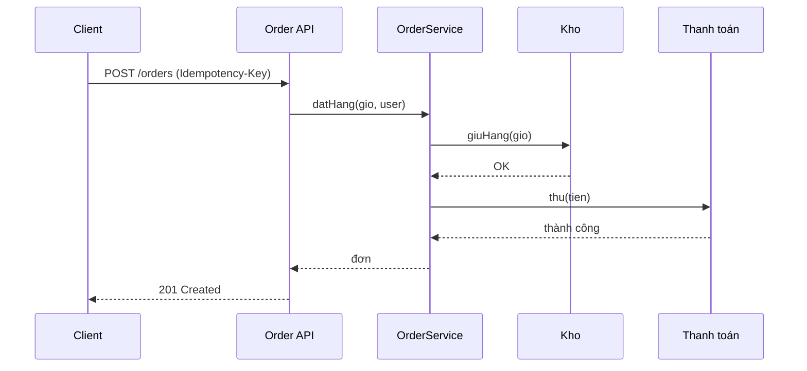

# 🗺️ Roadmap: Học Thiết kế Kiến trúc Phần mềm (Client–Server, REST API, Design Patterns)

> **Dành cho:** người **hoàn toàn mới** (chưa biết gì về lập trình hay kiến trúc) → đến mức **tự phân tích và thiết kế kiến trúc** một hệ thống thật.
>
> **Mục tiêu cuối cùng:** Khi đi hết roadmap, bạn có thể:
> - Nhìn một hệ thống (ví dụ: app đặt đồ ăn, shop điện thoại) và **vẽ được sơ đồ kiến trúc** của nó.
> - **Thiết kế REST API** đúng chuẩn cho một nghiệp vụ.
> - **Chọn đúng design pattern** cho một bài toán, và biết khi nào **không nên** dùng.
> - **Đánh giá trade-off** (đánh đổi) giữa các lựa chọn và **viết ADR** (ghi lại quyết định).
> - **Phân tích kiến trúc** của một dự án mã nguồn mở có sẵn.
>
> **Thời gian dự kiến:** 12–18 tháng nếu học 10–15 giờ/tuần (người mới hoàn toàn). Đã biết lập trình thì rút còn 6–9 tháng.
>
> **Ngôn ngữ ví dụ:** Code minh hoạ dùng **TypeScript** (dễ đọc) và **Java** (khớp với roadmap Spring Boot của bạn). Khái niệm không phụ thuộc ngôn ngữ — chọn ngôn ngữ nào cũng học được.

---

## 📑 Mục lục

0. [Bức tranh tổng thể: kiến trúc phần mềm là gì?](#muc-0)
1. [Phương pháp học](#muc-1)
2. [Giai đoạn 0 – Nền móng lập trình (cho người chưa biết gì)](#muc-2)
3. [Giai đoạn 1 – Mạng máy tính & HTTP](#muc-3)
4. [Giai đoạn 2 – Mô hình Client–Server](#muc-4)
5. [Giai đoạn 3 – REST API từ A đến Z](#muc-5)
6. [Giai đoạn 4 – Dữ liệu & Database cho kiến trúc sư](#muc-6)
7. [Giai đoạn 5 – Lập trình hướng đối tượng & nguyên lý SOLID](#muc-7)
8. [Giai đoạn 6 – Design Patterns (23 pattern kinh điển + pattern thực tế)](#muc-8)
9. [Giai đoạn 7 – Các kiến trúc phổ biến (Layered, Clean, Hexagonal, Microservices…)](#muc-9)
10. [Giai đoạn 8 – Chất lượng hệ thống: hiệu năng, mở rộng, độ tin cậy](#muc-10)
11. [Giai đoạn 9 – Bảo mật, kiểm thử, vận hành](#muc-11)
12. [Giai đoạn 10 – Quy trình PHÂN TÍCH & THIẾT KẾ kiến trúc](#muc-12)
13. [Giai đoạn 11 – Phân tích kiến trúc hệ thống có sẵn](#muc-13)
14. [Bài tập thực hành theo cấp độ (Dự án 1 → 5)](#muc-14)
15. [Lịch học mẫu theo tháng](#muc-15)
16. [Checklist tự đánh giá từng cấp độ](#muc-16)
17. [Tài nguyên học](#muc-17)

---

<a id="muc-0"></a>

## 0. Bức tranh tổng thể

### 0.1. Kiến trúc phần mềm là gì?

**Kiến trúc phần mềm** là cách bạn **chia một hệ thống thành các phần**, quyết định **mỗi phần làm gì**, và **các phần nói chuyện với nhau thế nào**. Nó trả lời những câu hỏi như:

- Hệ thống gồm bao nhiêu phần? Mỗi phần chạy ở đâu (máy nào, trình duyệt nào, server nào)?
- Dữ liệu được lưu ở đâu, ai được đọc/ghi?
- Khi có 10 người dùng → 10.000 người dùng, hệ thống có chịu được không?
- Khi sửa một tính năng, cần đụng bao nhiêu chỗ?

> 💡 **Ví dụ đời thường:** Xây nhà thì **kiến trúc** là bản vẽ: có bao nhiêu phòng, đường ống nước đi đâu, móng chịu được bao nhiêu tải. Còn **code** giống như thợ xây từng viên gạch. Thợ giỏi chưa chắc đã là kiến trúc sư giỏi.

### 0.2. Sơ đồ bản đồ kỹ năng

```
GIAI ĐOẠN 0: Nền móng lập trình (biến, hàm, vòng lặp, OOP cơ bản)
   │
   ▼
GIAI ĐOẠN 1: Mạng & HTTP  ──────────────┐
   │                                     │
   ▼                                     │
GIAI ĐOẠN 2: Client–Server               │
   │                                     │
   ▼                                     │
GIAI ĐOẠN 3: REST API  ◀─────────────────┘
   │
   ▼
GIAI ĐOẠN 4: Database  ──▶  GIAI ĐOẠN 5: OOP + SOLID
                                 │
                                 ▼
                      GIAI ĐOẠN 6: Design Patterns
                                 │
                                 ▼
                      GIAI ĐOẠN 7: Kiến trúc tổng thể
                                 │
                                 ▼
                      GIAI ĐOẠN 8: Chất lượng hệ thống
                                 │
                                 ▼
                      GIAI ĐOẠN 9: Bảo mật · Test · Vận hành
                                 │
                                 ▼
                      GIAI ĐOẠN 10: Quy trình thiết kế
                                 │
                                 ▼
                      GIAI ĐOẠN 11: Phân tích hệ thống thật
```

> ⚠️ **Quan trọng:** Đừng nhảy cóc. Nhiều người học Microservices, Kafka, Kubernetes khi chưa hiểu HTTP hay chưa biết viết một class tử tế — kết quả là **học thuộc tên công nghệ mà không hiểu vì sao cần nó**.

### 0.3. Ba nguyên tắc xuyên suốt

| Nguyên tắc | Ý nghĩa |
|---|---|
| **Không có kiến trúc "đúng" tuyệt đối** | Chỉ có kiến trúc **phù hợp** với yêu cầu, quy mô và đội ngũ. Luôn hỏi: "phù hợp với bài toán nào?" |
| **Mọi quyết định là một trade-off (đánh đổi)** | Nhanh hơn thường đổi lấy phức tạp hơn; linh hoạt hơn thường đổi lấy khó hiểu hơn. |
| **Đơn giản trước, phức tạp sau** | Bắt đầu với thứ đơn giản nhất chạy được. Chỉ thêm phức tạp khi có **lý do cụ thể** (đo được, gặp vấn đề thật). |

---

<a id="muc-1"></a>

## 1. Phương pháp học

### 1.1. Vòng lặp học 4 bước (áp dụng cho MỌI chủ đề)

```
  ┌─────────────┐     ┌─────────────┐     ┌─────────────┐     ┌─────────────┐
  │ 1. HIỂU     │ ──▶ │ 2. THẤY     │ ──▶ │ 3. LÀM      │ ──▶ │ 4. GIẢI THÍCH│
  │ khái niệm   │     │ ví dụ thật  │     │ bài tập nhỏ │     │ lại bằng lời │
  └─────────────┘     └─────────────┘     └─────────────┘     └──────┬──────┘
        ▲                                                           │
        └──────────────── Chưa giải thích được? → quay lại bước 1 ◀─┘
```

1. **Hiểu khái niệm:** đọc định nghĩa, nhưng quan trọng hơn là hiểu **vấn đề mà khái niệm đó sinh ra để giải quyết**.
2. **Thấy ví dụ thật:** tìm code/hệ thống thật dùng khái niệm đó (xem mục 13).
3. **Làm:** viết code nhỏ hoặc vẽ sơ đồ. Không làm = chưa học.
4. **Giải thích lại:** viết 5–10 dòng như thể dạy người khác. Nếu không viết được, bạn chưa hiểu.

### 1.2. Quy tắc học với AI (ChatGPT, Claude, Copilot…)

| Quy tắc | Cách làm |
|---|---|
| ✋ **Tự nghĩ trước, hỏi AI sau** | Tự phác thảo thiết kế 20–30 phút trước khi hỏi. |
| 🧠 **Hỏi "tại sao" và "khi nào"** | Thay vì "viết cho tôi cái này", hãy hỏi: "Tại sao dùng Strategy ở đây mà không dùng if-else?" |
| 🔍 **Kiểm chứng** | AI có thể bịa ví dụ hoặc nói sai. Đối chiếu với sách, tài liệu chính thức, và chính code của bạn. |
| ⚖️ **Luôn hỏi trade-off** | Mỗi khi AI đưa ra giải pháp, hỏi: "Nhược điểm là gì? Khi nào KHÔNG nên dùng?" |
| 📝 **Ghi chú bằng lời của mình** | Tạo thư mục `ghi-chu/` và viết ADR/nhật ký cho mỗi chủ đề. |

### 1.3. Dụng cụ cần có

- **Máy tính** có Git, một IDE (VS Code hoặc IntelliJ IDEA), trình duyệt.
- **Công cụ vẽ sơ đồ:** draw.io (miễn phí), Excalidraw, hoặc Mermaid (vẽ bằng text trong Markdown — rất hợp để lưu trong Git).
- **Postman** hoặc **Bruno** để gọi thử API.
- **Docker** (đến giai đoạn 9 mới cần).
- Một **repository Git** làm "sổ tay" — mỗi bài học là một commit.

---

<a id="muc-2"></a>

## 2. Giai đoạn 0 – Nền móng lập trình (cho người chưa biết gì)

> ⏱️ **Thời lượng:** 6–8 tuần · **Mục tiêu:** Viết được chương trình nhỏ có biến, điều kiện, vòng lặp, hàm, và hiểu lập trình hướng đối tượng ở mức cơ bản.

Nếu bạn đã biết lập trình, có thể lướt nhanh mục này và kiểm tra bằng bài tập cuối.

### 2.1. Máy tính "hiểu" chương trình như thế nào?

- **Chương trình** là tập hợp các **lệnh** mà máy tính thực hiện **từ trên xuống dưới**.
- **Dữ liệu** là thông tin (số, chữ, danh sách…) mà chương trình xử lý.
- Máy tính **không biết gì ngoài những gì bạn nói rõ ràng**. Đó là lý do lập trình đòi hỏi sự chính xác.

### 2.2. Các khái niệm cốt lõi

| Khái niệm | Ví dụ (TypeScript) | Giải thích ngắn |
|---|---|---|
| **Biến** | `let tuoi = 20;` | Hộp chứa dữ liệu có tên |
| **Kiểu dữ liệu** | `number`, `string`, `boolean` | Loại dữ liệu: số, chữ, đúng/sai |
| **Điều kiện** | `if (tuoi >= 18) { ... }` | Rẽ nhánh theo điều kiện |
| **Vòng lặp** | `for (let i = 0; i < 5; i++) { ... }` | Lặp lại một việc |
| **Mảng / danh sách** | `const diem = [8, 9, 7];` | Nhiều giá trị cùng loại |
| **Hàm** | `function cong(a: number, b: number) { return a + b; }` | Gói một việc để tái sử dụng |
| **Đối tượng** | `const sp = { ten: "iPhone", gia: 20000000 };` | Nhóm nhiều thông tin liên quan |

### 2.3. Lập trình hướng đối tượng (OOP) — mức cơ bản

**Ý tưởng:** Mô hình hoá thế giới thật bằng **đối tượng** (object) có **thuộc tính** (dữ liệu) và **hành vi** (hàm).

```typescript
// "Class" là bản thiết kế, "object" là sản phẩm cụ thể được tạo từ bản thiết kế đó
class SanPham {
  constructor(
    public ten: string,
    public gia: number,
    private soLuongTon: number,       // private: chỉ bên trong class được truy cập
  ) {}

  coTheBan(soLuong: number): boolean { // hành vi
    return this.soLuongTon >= soLuong;
  }

  banRa(soLuong: number): void {
    if (!this.coTheBan(soLuong)) {
      throw new Error("Không đủ hàng");
    }
    this.soLuongTon -= soLuong;
  }
}

const iphone = new SanPham("iPhone 15", 20_000_000, 10); // tạo object
iphone.banRa(3);
console.log(iphone.coTheBan(8)); // false — chỉ còn 7
```

Bốn "trụ cột" OOP bạn cần hiểu trực giác:

1. **Đóng gói (Encapsulation):** giấu dữ liệu bên trong, chỉ cho truy cập qua hành vi có kiểm soát (ví dụ: `soLuongTon` là `private`).
2. **Kế thừa (Inheritance):** lớp con "là một" lớp cha. Ví dụ `DienThoai` kế thừa `SanPham`.
3. **Đa hình (Polymorphism):** cùng một lời gọi nhưng hành vi khác nhau tuỳ đối tượng. Ví dụ `tinhThue()` của `SanPham` và `DichVu` khác nhau.
4. **Trừu tượng (Abstraction):** chỉ lộ ra "cái cần dùng", giấu "cách làm". Ví dụ: `interface ThanhToan { thanhToan(so: number): void }`.

> ⚠️ **Cảnh báo cho người mới:** Đừng lạm dụng kế thừa. Nguyên tắc sẽ học ở mục 6 (Design Patterns): **"Ưu tiên composition (kết hợp) hơn inheritance (kế thừa)"**.

### 2.4. Hàm thuần (pure function) và trạng thái (state) — khái niệm sẽ dùng rất nhiều

```typescript
// Hàm thuần: cùng input → cùng output, KHÔNG thay đổi gì bên ngoài
function tinhTongTien(gia: number, soLuong: number): number {
  return gia * soLuong;
}

// Hàm không thuần: đọc/ghi biến bên ngoài → khó đoán, khó test
let tongDon = 0;
function themVaoDon(gia: number) {
  tongDon += gia; // thay đổi trạng thái toàn cục
}
```

> 💡 **Vì sao quan trọng cho kiến trúc?** Các hệ thống lớn bị lỗi chủ yếu do **trạng thái bị thay đổi ở nơi không ai ngờ tới**. Ý thức được điều này sẽ giúp bạn thiết kế dễ kiểm soát hơn.

### 2.5. Bài tập cuối giai đoạn 0

1. Viết chương trình **quản lý giỏ hàng** trong bộ nhớ: thêm/xoá sản phẩm, tính tổng tiền.
2. Viết class `TaiKhoan` có số dư, phương thức `nap()` và `rut()` — `rut()` phải từ chối nếu không đủ tiền.
3. **Tự giải thích** (viết 5 dòng): OOP giải quyết vấn đề gì mà hàm thuần tuý không giải quyết tốt?

✅ **Đạt khi:** bạn làm được cả 3 bài và giải thích được bằng lời.

---

<a id="muc-3"></a>

## 3. Giai đoạn 1 – Mạng máy tính & HTTP

> ⏱️ **Thời lượng:** 4–5 tuần · **Mục tiêu:** Hiểu chuyện gì xảy ra khi bạn gõ `https://shop.com` và nhấn Enter.

Không hiểu mạng và HTTP thì **không thể thiết kế REST API** hay **client–server** một cách thật sự.

### 3.1. Internet và các "tầng" (layers)

Dữ liệu đi qua Internet theo nhiều tầng, mỗi tầng có nhiệm vụ riêng. Bạn **không cần nhớ hết**, nhưng cần hiểu **ý tưởng phân tầng** — đây cũng chính là ý tưởng kiến trúc!

```
┌────────────────────────────────────────────┐
│ Tầng ỨNG DỤNG  : HTTP, HTTPS, DNS, SMTP     │  ← bạn làm việc chủ yếu ở đây
├────────────────────────────────────────────┤
│ Tầng VẬN CHUYỂN: TCP (đáng tin), UDP (nhanh)│  ← đảm bảo dữ liệu đến đủ, đúng thứ tự
├────────────────────────────────────────────┤
│ Tầng MẠNG      : IP (địa chỉ, định tuyến)   │  ← tìm đường đi giữa các máy
├────────────────────────────────────────────┤
│ Tầng LIÊN KẾT  : Wi-Fi, Ethernet            │  ← truyền trên dây/sóng
└────────────────────────────────────────────┘
```

### 3.2. Chuyện gì xảy ra khi bạn gõ `https://shop.com/api/products`?

```
Trình duyệt                 DNS                  Server shop.com
    │                        │                          │
    │── 1. Hỏi IP của ───────▶│                          │
    │   shop.com              │                          │
    │◀── 2. Trả về 203.0.113.5│                          │
    │                                                    │
    │── 3. Bắt tay TCP (3 bước) ────────────────────────▶│
    │── 4. Bắt tay TLS (HTTPS, mã hoá) ─────────────────▶│
    │── 5. HTTP GET /api/products ──────────────────────▶│
    │                                                    │ (server xử lý)
    │◀── 6. HTTP 200 OK + dữ liệu JSON ──────────────────│
    │                                                    │
```

Các bước này là nền tảng để hiểu **latency** (độ trễ), **caching**, và **tại sao cần giảm số lần gọi qua mạng**.

### 3.3. Địa chỉ và cổng

- **IP address:** địa chỉ của máy (`203.0.113.5`, hoặc `localhost` = `127.0.0.1` là chính máy bạn).
- **Port:** "cửa" trên máy. HTTP mặc định `80`, HTTPS `443`, Spring Boot thường `8080`, React dev server thường `3000` hoặc `5173`.
- **Domain:** tên dễ nhớ (`shop.com`) được DNS đổi thành IP.

### 3.4. HTTP — giao thức "ngôn ngữ" của web

HTTP hoạt động theo mô hình **request–response**: client gửi yêu cầu, server trả lời. Mỗi cặp là **độc lập** (**stateless**).

#### Cấu trúc một request

```http
POST /api/orders HTTP/1.1
Host: shop.com
Content-Type: application/json
Authorization: Bearer eyJhbGciOi...

{
  "productId": 42,
  "quantity": 2
}
```

#### Cấu trúc một response

```http
HTTP/1.1 201 Created
Content-Type: application/json
Location: /api/orders/1007

{
  "id": 1007,
  "status": "PENDING",
  "total": 40000000
}
```

| Thành phần | Vai trò |
|---|---|
| **Method** (`GET`, `POST`…) | Hành động muốn làm |
| **URL/Path** | Tài nguyên muốn tác động |
| **Headers** | Thông tin phụ (kiểu dữ liệu, xác thực, ngôn ngữ…) |
| **Body** | Dữ liệu gửi kèm (không có trong `GET`) |
| **Status code** | Kết quả (xem bảng dưới) |

#### Các status code cần thuộc lòng

| Nhóm | Ý nghĩa | Ví dụ thường gặp |
|---|---|---|
| **2xx** | Thành công | `200 OK`, `201 Created`, `204 No Content` |
| **3xx** | Chuyển hướng | `301 Moved Permanently`, `304 Not Modified` |
| **4xx** | **Lỗi do client** | `400 Bad Request`, `401 Unauthorized`, `403 Forbidden`, `404 Not Found`, `409 Conflict`, `422 Unprocessable`, `429 Too Many Requests` |
| **5xx** | **Lỗi do server** | `500 Internal Server Error`, `502 Bad Gateway`, `503 Service Unavailable` |

> 💡 **Quy tắc vàng:** `4xx` = "bạn gửi sai, sửa rồi thử lại"; `5xx` = "tôi (server) hỏng, bạn thử lại sau". Đừng trả `200 OK` kèm `{"error": "..."}` — đó là lỗi thiết kế phổ biến nhất.

### 3.5. HTTPS, cookie, header quan trọng

- **HTTPS** = HTTP + **TLS** (mã hoá). Ngày nay mọi API thật đều phải dùng HTTPS.
- **Cookie:** server gửi `Set-Cookie`, trình duyệt tự gửi lại mỗi request. Dùng để lưu phiên đăng nhập.
- **CORS:** trình duyệt chặn trang web (`localhost:3000`) gọi API ở domain khác (`localhost:8080`) nếu server không cho phép. Đây là lỗi bạn **sẽ gặp** khi làm React + Spring Boot.
- **Cache headers:** `Cache-Control`, `ETag` — giúp giảm số lần tải lại dữ liệu.

### 3.6. Bài tập giai đoạn 1

1. Dùng trình duyệt (tab **Network** trong DevTools) để xem các request khi mở một trang web bất kỳ. Ghi lại: 3 request có method khác nhau, 1 request có status `304`.
2. Dùng `curl -i https://jsonplaceholder.typicode.com/posts/1` để xem response thô. Ghi lại từng header.
3. Dùng `curl -i -X POST https://jsonplaceholder.typicode.com/posts -H "Content-Type: application/json" -d '{"title":"hi","body":"x","userId":1}'`. Giải thích status code trả về.
4. **Giải thích bằng lời:** Vì sao HTTP được gọi là *stateless*? Điều này gây khó khăn gì khi làm đăng nhập?

✅ **Đạt khi:** bạn đọc được một request/response bất kỳ và nói được ý nghĩa từng phần.

---

<a id="muc-4"></a>

## 4. Giai đoạn 2 – Mô hình Client–Server

> ⏱️ **Thời lượng:** 3–4 tuần · **Mục tiêu:** Hiểu ai làm gì trong một hệ thống web, và vì sao lại chia như vậy.

### 4.1. Định nghĩa

- **Client (máy khách):** bên **yêu cầu** dịch vụ. Ví dụ: trình duyệt, app điện thoại, một chương trình khác.
- **Server (máy chủ):** bên **cung cấp** dịch vụ, luôn lắng nghe và trả lời yêu cầu.

```
   ┌──────────────┐   yêu cầu (request)    ┌──────────────┐
   │   CLIENT     │ ─────────────────────▶ │   SERVER     │
   │ (trình duyệt,│                        │ (xử lý logic,│
   │  app mobile) │ ◀───────────────────── │  giữ dữ liệu)│
   └──────────────┘   phản hồi (response)  └──────────────┘
```

> ⚠️ Một máy có thể vừa là client vừa là server (ví dụ: server Spring Boot gọi API thanh toán VNPay → Spring Boot là client của VNPay).

### 4.2. Các kiểu kiến trúc Client–Server (từ đơn giản đến phức tạp)

#### 4.2.1. Kiến trúc 1 tầng (Single-tier)
Mọi thứ (giao diện, logic, dữ liệu) nằm trên **một máy**. Ví dụ: app Notepad. Đơn giản nhưng không chia sẻ dữ liệu được.

#### 4.2.2. Kiến trúc 2 tầng (Two-tier)
```
  [Client: giao diện + một phần logic]  ──▶  [Database]
```
Ví dụ: app desktop kết nối thẳng database. **Vấn đề:** mọi client phải biết cách truy cập DB → khó bảo mật, khó đổi DB, khó cập nhật.

#### 4.2.3. Kiến trúc 3 tầng (Three-tier) — **kiến trúc kinh điển của web**
```
  ┌──────────────┐        ┌──────────────┐        ┌──────────────┐
  │ PRESENTATION │ ─────▶ │   LOGIC      │ ─────▶ │     DATA     │
  │  (Frontend)  │ ◀───── │  (Backend)   │ ◀───── │  (Database)  │
  │ React/Next   │        │ Spring Boot  │        │ PostgreSQL   │
  └──────────────┘        └──────────────┘        └──────────────┘
```

Lợi ích:
- **Tách biệt trách nhiệm:** giao diện không biết cách lưu DB.
- **Bảo mật:** client không truy cập trực tiếp DB.
- **Độc lập phát triển:** frontend và backend có thể do 2 đội làm song song.

#### 4.2.4. Kiến trúc N tầng (N-tier)
Thêm các tầng khác: cache (Redis), hàng đợi (RabbitMQ), gateway, dịch vụ ngoài… Đây là hướng phát triển tự nhiên của hệ thống thật.

### 4.3. Thin client vs Fat client

| | **Thin client** (client mỏng) | **Fat client** (client béo) |
|---|---|---|
| Logic nằm ở | Server | Client |
| Ví dụ | Trang web gọi API, app đơn giản | App Photoshop, game online có tính toán nhiều |
| Ưu điểm | Dễ cập nhật, nhất quán | Phản hồi nhanh, dùng được khi offline |
| Nhược điểm | Phụ thuộc mạng | Khó cập nhật, dễ lệch logic giữa các client |

> 💡 Web hiện đại thường là **thin client** cho nghiệp vụ, nhưng dùng **fat client** một phần (xử lý giao diện, validate form, cache tạm).

### 4.4. Stateful vs Stateless

- **Stateful (có trạng thái):** server **nhớ** thông tin về client giữa các request (ví dụ: session lưu trong RAM).
- **Stateless (không trạng thái):** mỗi request **tự mang đủ thông tin** (ví dụ: JWT token trong header).

```
STATEFUL:                               STATELESS:
Request 1: "tôi là user 5"              Request 1: [Token: user=5] "lấy đơn hàng"
   Server: nhớ "user 5 đã đăng nhập"    Request 2: [Token: user=5] "lấy giỏ hàng"
Request 2: "lấy giỏ hàng"               Server: không nhớ gì, tự đọc token mỗi lần
   Server: tra trong bộ nhớ của mình
```

| Tiêu chí | Stateful | Stateless |
|---|---|---|
| Mở rộng (thêm nhiều server) | ❌ Khó — phải đồng bộ session | ✅ Dễ — server nào cũng được |
| Dễ triển khai | ✅ Quen thuộc | ⚠️ Cần thiết kế token |
| Thu hồi quyền ngay lập tức | ✅ Xoá session là xong | ⚠️ Khó — token vẫn còn hạn |

> 🎯 **Vì sao REST yêu cầu stateless?** Để hệ thống **mở rộng ngang** (scale out) bằng cách thêm nhiều máy chủ phía sau một bộ cân bằng tải (load balancer).

### 4.5. Vòng đời một yêu cầu trong kiến trúc 3 tầng

```
Client ─▶ Controller ─▶ Service ─▶ Repository ─▶ Database
  ▲          │             │           │             │
  └──────────┴─────────────┴───────────┴─────────────┘
              (dữ liệu đi ngược về theo cùng đường)
```

- **Controller:** nhận request, kiểm tra đầu vào cơ bản, gọi Service, trả response.
- **Service:** chứa **nghiệp vụ** (business logic) — "đơn hàng chỉ được huỷ khi chưa giao".
- **Repository:** nói chuyện với database.

Đây là **kiến trúc phân lớp (Layered)** — sẽ học sâu ở giai đoạn 7.

### 4.6. Bài tập giai đoạn 2

1. Vẽ sơ đồ **3 tầng** cho một app đặt đồ ăn: nêu rõ mỗi tầng có những thành phần gì (ít nhất 3 thành phần/tầng).
2. Liệt kê 5 chức năng và **phân loại** mỗi chức năng thuộc tầng nào: "hiển thị menu", "tính phí ship", "lưu đơn hàng", "validate số điện thoại", "gửi email xác nhận".
3. Trả lời: nếu bạn để frontend **gọi thẳng database**, hãy nêu 3 rủi ro cụ thể.

✅ **Đạt khi:** bạn phân loại đúng và giải thích được vì sao logic tính giá **không nên** nằm ở frontend.

---

<a id="muc-5"></a>

## 5. Giai đoạn 3 – REST API từ A đến Z

> ⏱️ **Thời lượng:** 5–6 tuần · **Mục tiêu:** Thiết kế được REST API chuẩn cho một nghiệp vụ, có tài liệu, có xử lý lỗi, có phân trang.

### 5.1. REST là gì?

**REST (Representational State Transfer)** là một **phong cách kiến trúc** (không phải giao thức) do Roy Fielding đề xuất năm 2000 trong luận án tiến sĩ. Nó dựa trên các **ràng buộc** (constraints):

| Ràng buộc | Ý nghĩa |
|---|---|
| **Client–Server** | Tách client và server |
| **Stateless** | Mỗi request tự chứa đủ thông tin |
| **Cacheable** | Response phải nói rõ có được cache không |
| **Uniform Interface** | Giao diện thống nhất (tài nguyên, method, representation) |
| **Layered System** | Client không cần biết có bao nhiêu tầng phía sau |
| **Code on Demand** (tuỳ chọn) | Server có thể gửi code thực thi (ít dùng) |

> 💡 **Trên thực tế**, khi người ta nói "REST API" thường có nghĩa là: **API HTTP + JSON + thiết kế theo tài nguyên + dùng đúng method và status code**.

### 5.2. Tư duy đúng: tài nguyên (resource), không phải hành động

**Sai** (kiểu RPC — gọi hàm qua mạng):
```
POST /createProduct
POST /deleteProduct?id=5
GET  /getAllOrders
POST /updateOrderStatus
```

**Đúng** (kiểu REST — hướng tài nguyên):
```
GET    /products          → lấy danh sách sản phẩm
POST   /products          → tạo sản phẩm mới
GET    /products/42       → lấy sản phẩm 42
PUT    /products/42       → thay thế toàn bộ sản phẩm 42
PATCH  /products/42       → cập nhật một phần sản phẩm 42
DELETE /products/42       → xoá sản phẩm 42
GET    /products/42/reviews   → lấy đánh giá của sản phẩm 42
```

**Quy tắc đặt tên:**
- Dùng **danh từ số nhiều**: `/products`, không phải `/product` hay `/getProducts`.
- Dùng **chữ thường, gạch ngang**: `/order-items`, không phải `/orderItems`.
- Quan hệ lồng nhau tối đa **2 cấp**: `/users/5/orders` được; `/users/5/orders/7/items/3/options` là quá sâu → nên viết `/order-items/3`.

### 5.3. HTTP method: ý nghĩa và tính chất

| Method | Mục đích | Có body? | **Idempotent** (gọi nhiều lần cho kết quả như một lần)? | **Safe** (không thay đổi dữ liệu)? |
|---|---|---|---|---|
| `GET` | Đọc | ❌ | ✅ | ✅ |
| `POST` | Tạo mới / hành động | ✅ | ❌ | ❌ |
| `PUT` | Thay thế toàn bộ | ✅ | ✅ | ❌ |
| `PATCH` | Sửa một phần | ✅ | ⚠️ thường là có | ❌ |
| `DELETE` | Xoá | ❌ | ✅ | ❌ |

> ⚠️ **Idempotent là gì?** Nếu bạn bấm "xoá sản phẩm 42" hai lần, kết quả vẫn là "sản phẩm 42 không tồn tại" → `DELETE` idempotent. Nhưng bấm "tạo đơn hàng" hai lần sẽ tạo **hai đơn** → `POST` không idempotent. Đây là lý do **mạng chập chờn** có thể gây đặt hàng trùng → cần **Idempotency-Key** (sẽ học ở giai đoạn 8).

### 5.4. Thiết kế một API hoàn chỉnh: ví dụ "Quản lý sản phẩm"

```
# Danh sách, có lọc + phân trang + sắp xếp
GET /api/v1/products?category=phone&minPrice=5000000&page=1&size=20&sort=price,asc

# Chi tiết
GET /api/v1/products/42

# Tạo (yêu cầu đăng nhập, quyền ADMIN)
POST /api/v1/products
{
  "name": "iPhone 15",
  "price": 20000000,
  "categoryId": 3,
  "stock": 10
}
→ 201 Created
  Location: /api/v1/products/42

# Cập nhật một phần
PATCH /api/v1/products/42
{ "price": 18500000 }
→ 200 OK

# Xoá
DELETE /api/v1/products/42
→ 204 No Content
```

#### Định dạng lỗi thống nhất (rất quan trọng)

```json
// HTTP/1.1 422 Unprocessable Entity
{
  "timestamp": "2026-11-13T10:20:30Z",
  "status": 422,
  "error": "VALIDATION_FAILED",
  "message": "Dữ liệu không hợp lệ",
  "path": "/api/v1/products",
  "details": [
    { "field": "price", "message": "phải lớn hơn 0" },
    { "field": "name",  "message": "không được để trống" }
  ]
}
```

> 💡 Mọi lỗi nên có **cùng một cấu trúc**. Frontend chỉ cần viết một bộ xử lý lỗi duy nhất.

### 5.5. Phân trang, lọc, sắp xếp

| Kỹ thuật | Ví dụ | Khi nào dùng |
|---|---|---|
| **Offset/limit** | `?page=2&size=20` | Dữ liệu ít thay đổi, cần nhảy trang |
| **Cursor** | `?cursor=eyJpZCI6NDJ9&size=20` | Dữ liệu lớn, thay đổi liên tục (feed mạng xã hội) |

> ⚠️ **Không bao giờ** trả về toàn bộ bảng dữ liệu (ví dụ 1 triệu sản phẩm) trong một response.

### 5.6. Versioning (phiên bản hoá API)

- **URL:** `/api/v1/products` — phổ biến nhất, dễ hiểu.
- **Header:** `Accept: application/vnd.shop.v2+json` — "sạch" hơn nhưng khó thử bằng trình duyệt.

Quy tắc: khi **thay đổi không tương thích** (breaking change — đổi tên trường, xoá trường), phải tăng phiên bản. Thay đổi tương thích (thêm trường mới) thì không cần.

### 5.7. Các mức trưởng thành REST (Richardson Maturity Model)

```
Level 3: HATEOAS  ── response có liên kết đến hành động tiếp theo
   ▲
Level 2: HTTP Verbs + Status codes đúng nghĩa   ← MỤC TIÊU THỰC TẾ CỦA ĐA SỐ DỰ ÁN
   ▲
Level 1: Tài nguyên (có URL riêng cho từng resource)
   ▲
Level 0: Một URL duy nhất, mọi thứ POST (kiểu RPC)
```

> 🎯 Đa số công ty dừng ở **Level 2**. HATEOAS là hay, nhưng hiếm khi đáng công sức trong dự án thường. Hãy biết nó để giải thích được khi được hỏi.

Ví dụ HATEOAS (Level 3):
```json
{
  "id": 1007,
  "status": "PENDING",
  "_links": {
    "self":   { "href": "/api/v1/orders/1007" },
    "cancel": { "href": "/api/v1/orders/1007/cancel", "method": "POST" },
    "pay":    { "href": "/api/v1/orders/1007/pay",    "method": "POST" }
  }
}
```

### 5.8. Tài liệu hoá API bằng OpenAPI (Swagger)

API không có tài liệu = API không ai dùng được. Chuẩn phổ biến là **OpenAPI 3**:

```yaml
openapi: 3.0.3
info:
  title: Shop API
  version: 1.0.0
paths:
  /api/v1/products/{id}:
    get:
      summary: Lấy chi tiết sản phẩm
      parameters:
        - name: id
          in: path
          required: true
          schema: { type: integer }
      responses:
        "200":
          description: Thành công
          content:
            application/json:
              schema:
                $ref: "#/components/schemas/Product"
        "404":
          description: Không tìm thấy sản phẩm
components:
  schemas:
    Product:
      type: object
      properties:
        id:    { type: integer, example: 42 }
        name:  { type: string,  example: "iPhone 15" }
        price: { type: number,  example: 20000000 }
```

### 5.9. Bảo vệ API cơ bản

- **Xác thực (Authentication):** "bạn là ai?" — Bearer token (JWT), API key.
- **Phân quyền (Authorization):** "bạn được làm gì?" — `ADMIN` được xoá, `USER` chỉ được xem.
- **Rate limiting:** giới hạn số request/phút để chống lạm dụng → trả `429 Too Many Requests`.
- **Validate đầu vào:** không tin bất kỳ dữ liệu nào từ client.

### 5.10. Bài tập giai đoạn 3

1. Thiết kế REST API cho **"Thư viện sách"**: sách, tác giả, người mượn, phiếu mượn. Viết ra bảng: method + URL + mô tả + status code thành công + status code lỗi. (Ít nhất 15 endpoint.)
2. Chọn 3 endpoint, viết OpenAPI tương ứng.
3. Gọi API công khai (ví dụ `https://api.github.com`) bằng Postman. Phân tích: URL đặt tên thế nào? Phân trang bằng gì? Lỗi trả về có cấu trúc gì?
4. **Phê bình thiết kế:** cho 5 URL sai sau, sửa lại và giải thích:
   - `POST /getUserById`
   - `GET /deleteOrder/5`
   - `POST /products/update/42`
   - `GET /api/users/5/orders/9/items/2/details`
   - `GET /products?page=1` (trả về 10 triệu bản ghi)

✅ **Đạt khi:** API bạn thiết kế có tài nguyên danh từ, đúng method, đúng status code, lỗi có cấu trúc, và có phân trang.

---

<a id="muc-6"></a>

## 6. Giai đoạn 4 – Dữ liệu & Database cho kiến trúc sư

> ⏱️ **Thời lượng:** 4–5 tuần · **Mục tiêu:** Thiết kế được sơ đồ dữ liệu, chọn đúng loại database, hiểu transaction và index.

Kiến trúc sư không cần viết tối ưu SQL như DBA, nhưng **phải hiểu** dữ liệu được lưu và truy vấn thế nào, vì đây là nơi **hệ thống chậm và hỏng nhiều nhất**.

### 6.1. Các loại database và khi nào dùng

| Loại | Ví dụ | Dữ liệu phù hợp | Ví dụ ứng dụng |
|---|---|---|---|
| **Quan hệ (SQL)** | PostgreSQL, MySQL | Dữ liệu có cấu trúc, quan hệ rõ, cần toàn vẹn | Đơn hàng, tài khoản, tồn kho |
| **Key–Value** | Redis | Truy cập theo khoá cực nhanh | Cache, session, giỏ hàng tạm |
| **Document** | MongoDB | Dữ liệu linh hoạt, lồng nhau | Hồ sơ sản phẩm có thuộc tính khác nhau |
| **Column-family** | Cassandra | Ghi khối lượng lớn, phân tán | Log, dữ liệu IoT |
| **Graph** | Neo4j | Quan hệ phức tạp nhiều tầng | Gợi ý bạn bè, phát hiện gian lận |
| **Search engine** | Elasticsearch | Tìm kiếm toàn văn | Tìm sản phẩm theo từ khoá |

> 🎯 **Mặc định an toàn:** Bắt đầu với **PostgreSQL**. Chỉ thêm loại khác khi có lý do cụ thể đo được (xem mục 9 về "polyglot persistence").

### 6.2. Thiết kế sơ đồ dữ liệu (ER Diagram)

```
┌──────────────┐       ┌──────────────┐       ┌──────────────┐
│    USER      │ 1   n │    ORDER     │ 1   n │  ORDER_ITEM  │
├──────────────┤───────├──────────────┤───────├──────────────┤
│ id (PK)      │       │ id (PK)      │       │ id (PK)      │
│ email (UQ)   │       │ user_id (FK) │       │ order_id(FK) │
│ password_hash│       │ status       │       │ product_id   │
│ created_at   │       │ total        │       │ quantity     │
└──────────────┘       └──────────────┘       │ unit_price   │
                                              └──────┬───────┘
                                                     │ n   1
                                              ┌──────┴───────┐
                                              │   PRODUCT    │
                                              ├──────────────┤
                                              │ id (PK)      │
                                              │ name         │
                                              │ price        │
                                              └──────────────┘
```

Thuật ngữ:
- **PK (Primary Key):** khoá chính, định danh duy nhất một dòng.
- **FK (Foreign Key):** khoá ngoại, trỏ đến PK của bảng khác.
- **UQ (Unique):** giá trị không được trùng.
- **1–n, n–n:** quan hệ một–nhiều, nhiều–nhiều. Quan hệ n–n luôn cần một bảng trung gian.

### 6.3. Chuẩn hoá (Normalization) — hiểu ý tưởng

**Mục tiêu:** tránh lặp dữ liệu, tránh mâu thuẫn khi sửa.

```
❌ CHƯA CHUẨN HOÁ (lặp dữ liệu):
ORDER: id | customer_name | customer_phone | customer_address | items...
→ Khách đổi số điện thoại: phải sửa ở MỌI đơn cũ. Quên một chỗ → mâu thuẫn.

✅ ĐÃ CHUẨN HOÁ:
CUSTOMER: id | name | phone | address
ORDER:    id | customer_id (FK) | ...
→ Sửa ở một chỗ duy nhất.
```

> ⚖️ **Trade-off:** Chuẩn hoá quá mức làm truy vấn phức tạp, chậm. **Phi chuẩn hoá có chủ đích** (denormalization) đôi khi là lựa chọn đúng — nhưng phải biết mình đang đánh đổi gì.

### 6.4. Transaction và tính chất ACID

Transaction = **một nhóm thao tác phải thành công hết hoặc thất bại hết**.

```
Chuyển 1 triệu từ ví A sang ví B:
  1. Trừ 1.000.000 của A
  2. Cộng 1.000.000 cho B
Nếu bước 2 lỗi mà bước 1 đã chạy → A mất tiền oan.
→ Phải gói cả 2 bước trong MỘT transaction.
```

| Chữ | Nghĩa | Ý nghĩa thực tế |
|---|---|---|
| **A**tomicity | Nguyên tử | Hết hoặc không gì cả |
| **C**onsistency | Nhất quán | Dữ liệu luôn thoả các ràng buộc |
| **I**solation | Cô lập | Hai giao dịch chạy song song không "giẫm" nhau |
| **D**urability | Bền vững | Đã commit là không mất, kể cả khi máy sập |

Mức cô lập (isolation level) và các lỗi đồng thời (dirty read, lost update, phantom read) là phần **nâng cao** — sẽ học ở giai đoạn 8.

### 6.5. Index — tăng tốc đọc, đổi bằng tốc độ ghi và dung lượng

```
Không có index: tìm "iPhone" trong 1 triệu dòng → quét tuần tự (chậm)
Có index trên cột name: như mục lục sách → nhảy thẳng đến trang (nhanh)
```

Quy tắc:
- Đánh index trên cột hay **dùng trong `WHERE`, `JOIN`, `ORDER BY`**.
- Index **không miễn phí**: mỗi lần `INSERT/UPDATE` phải cập nhật index.
- Đừng đánh index bừa — **đo trước khi tối ưu** (`EXPLAIN ANALYZE` trong PostgreSQL).

### 6.6. Vấn đề N+1 — lỗi hiệu năng phổ biến nhất

```
Lấy 50 đơn hàng → 1 query lấy 50 đơn
Với mỗi đơn, lấy user của đơn đó → 50 query
Tổng: 51 query thay vì 2 query (hoặc 1 JOIN)
```

Đây là lỗi bạn **gặp chắc chắn** khi dùng ORM (Hibernate, Prisma, TypeORM). Phải biết nó để phát hiện qua log SQL.

### 6.7. Migration — quản lý thay đổi schema

Database **thay đổi theo thời gian**. Không ai sửa tay trên production. Dùng công cụ migration (Flyway, Liquibase, Prisma Migrate):

```
V1__create_users.sql
V2__create_orders.sql
V3__add_column_phone_to_users.sql
```

### 6.8. Bài tập giai đoạn 4

1. Thiết kế ER cho **"Shop điện thoại"**: user, product, category, cart, order, order_item, payment, address. Ghi rõ PK, FK, quan hệ.
2. Chỉ ra một chỗ **vi phạm chuẩn hoá** trong thiết kế của bạn và sửa.
3. Mô tả một **transaction** cần thiết trong "đặt hàng" (trừ tồn kho + tạo đơn + ghi thanh toán). Nếu bước 3 lỗi thì sao?
4. Cài PostgreSQL (hoặc Docker `postgres`), tạo 2 bảng có FK, chạy `EXPLAIN` một truy vấn JOIN và đọc kết quả.

✅ **Đạt khi:** bạn vẽ được ER đúng quan hệ, giải thích được transaction bằng ví dụ cụ thể, và biết khi nào nên đánh index.

---

<a id="muc-7"></a>

## 7. Giai đoạn 5 – Lập trình hướng đối tượng & nguyên lý SOLID

> ⏱️ **Thời lượng:** 4–5 tuần · **Mục tiêu:** Viết được code có cấu trúc tốt, dễ thay đổi. Đây là **nền tảng để hiểu design pattern**.

### 7.1. Vì sao cần nguyên lý thiết kế?

Code ban đầu chạy được, nhưng sau 1 năm:
- Sửa một tính năng nhỏ làm hỏng 5 tính năng khác.
- Không ai dám đụng vào file `OrderService.java` dài 3.000 dòng.
- Thêm một phương thức thanh toán mới phải sửa 12 chỗ.

**SOLID** là 5 nguyên lý giúp tránh những tình huống trên.

### 7.2. S — Single Responsibility (Trách nhiệm đơn lẻ)

> *Một class chỉ nên có MỘT lý do để thay đổi.*

```typescript
// ❌ Vi phạm: một class làm đủ thứ
class DonHang {
  tinhTongTien() { /* ... */ }
  luuVaoDatabase() { /* SQL ở đây */ }
  guiEmailXacNhan() { /* SMTP ở đây */ }
  inHoaDonPDF() { /* ... */ }
}

// ✅ Tách trách nhiệm
class DonHang { tinhTongTien() { /* ... */ } }
class DonHangRepository { luu(don: DonHang) { /* ... */ } }
class EmailService { guiXacNhan(don: DonHang) { /* ... */ } }
class HoaDonPdfService { taoPdf(don: DonHang) { /* ... */ } }
```

### 7.3. O — Open/Closed (Mở để mở rộng, đóng để sửa đổi)

> *Thêm tính năng bằng cách THÊM code mới, không phải SỬA code cũ đã chạy ổn.*

```typescript
// ❌ Mỗi phương thức thanh toán mới phải sửa hàm này
function thanhToan(loai: string, so: number) {
  if (loai === "momo") { /* ... */ }
  else if (loai === "vnpay") { /* ... */ }
  // thêm ZaloPay → sửa tiếp...
}

// ✅ Thêm phương thức mới = thêm class mới
interface PhuongThucThanhToan {
  thanhToan(so: number): void;
}
class MoMo implements PhuongThucThanhToan { thanhToan(so: number) { /* ... */ } }
class VnPay implements PhuongThucThanhToan { thanhToan(so: number) { /* ... */ } }
// ZaloPay: chỉ cần thêm class mới, không đụng code cũ
```

### 7.4. L — Liskov Substitution (Thay thế Liskov)

> *Class con phải thay thế được class cha mà chương trình không bị lỗi.*

```typescript
class Hinh { tinhDienTich(): number { return 0; } }
class HinhChuNhat extends Hinh { constructor(public d: number, public r: number) { super(); } tinhDienTich() { return this.d * this.r; } }
class HinhVuong extends HinhChuNhat {
  constructor(c: number) { super(c, c); }
  // ❌ Nếu HinhVuong cho phép đặt chiều dài và chiều rộng khác nhau,
  //    nó vi phạm kỳ vọng của HinhChuNhat → lỗi khó thấy.
}
```

> 💡 **Dấu hiệu vi phạm LSP:** class con phải `throw new Error("Không hỗ trợ")` cho một phương thức của cha, hoặc phải kiểm tra `instanceof` trước khi gọi.

### 7.5. I — Interface Segregation (Tách interface)

> *Đừng ép client phụ thuộc vào những phương thức nó không dùng.*

```typescript
// ❌ Interface "béo"
interface MayIn { in(): void; quet(): void; faxe(): void; }
// Máy in đơn giản phải "implement" cả quét và fax → toàn throw Error

// ✅ Tách nhỏ
interface MayIn { in(): void; }
interface MayQuet { quet(): void; }
interface MayFax { faxe(): void; }
```

### 7.6. D — Dependency Inversion (Đảo ngược phụ thuộc)

> *Module cấp cao không nên phụ thuộc vào module cấp thấp. Cả hai nên phụ thuộc vào **abstraction** (interface).*

```typescript
// ❌ Service phụ thuộc trực tiếp vào implementation cụ thể
class DatHangService {
  private db = new MySqlDatabase();           // gắn chặt MySQL
  dat(don: DonHang) { this.db.insert(don); }
}

// ✅ Service phụ thuộc vào interface, implementation được "tiêm" vào từ ngoài
interface DonHangRepo { luu(don: DonHang): void; }

class DatHangService {
  constructor(private repo: DonHangRepo) {}   // Dependency Injection
  dat(don: DonHang) { this.repo.luu(don); }
}

// Test: tiêm bản giả
class FakeRepo implements DonHangRepo { luu() { /* lưu vào mảng */ } }
const service = new DatHangService(new FakeRepo());
```

> 🎯 Đây chính là nền tảng của **Spring Boot** (`@Autowired`, constructor injection) và của hầu hết kiến trúc sạch (Clean/Hexagonal — giai đoạn 7).

### 7.7. Coupling và Cohesion — hai khái niệm đo "chất lượng" kiến trúc

| Khái niệm | Định nghĩa | Mong muốn |
|---|---|---|
| **Coupling (độ gắn kết giữa các module)** | Module A biết bao nhiêu về module B | **Thấp** |
| **Cohesion (độ tập trung bên trong module)** | Các phần trong module liên quan nhau đến mức nào | **Cao** |

```
TỐT:   [Module Đơn hàng] ──ít──▶ [Module Thanh toán]     (cohesion cao bên trong mỗi module)
XẤU:   [Module Đơn hàng] ◀═══════▶ [Module Kho]          (phụ thuộc chằng chịt)
```

### 7.8. Code smell — dấu hiệu code đang "có vấn đề"

| Smell | Biểu hiện | Hướng xử lý |
|---|---|---|
| **God class** | Một class > 1000 dòng, làm mọi thứ | Tách theo SRP |
| **Long method** | Hàm > 50 dòng | Tách hàm nhỏ có tên rõ ràng |
| **Duplicate code** | Copy–paste cùng logic 3 nơi | Gom về một hàm/class |
| **Feature envy** | Hàm dùng dữ liệu của class khác nhiều hơn của chính nó | Chuyển hàm sang class đó |
| **Primitive obsession** | Dùng `string` cho mọi thứ (email, số điện thoại, tiền) | Tạo kiểu riêng (`Email`, `Money`) |
| **Shotgun surgery** | Sửa 1 tính năng phải sửa 10 file | Gom trách nhiệm liên quan lại |
| **Magic number** | `if (status == 3)` | Dùng hằng số `TRANG_THAI_DA_GIAO` |

### 7.9. Bài tập giai đoạn 5

1. Lấy một đoạn code bạn từng viết (hoặc tự viết 100 dòng), tìm **ít nhất 3 code smell** trong bảng trên và refactor.
2. Viết lại một class vi phạm **DIP**: thay vì `new` trực tiếp, hãy inject qua constructor. Viết một test với bản giả.
3. Tạo hệ thống "thông báo": có Email, SMS, Push. Thiết kế theo **OCP** — thêm kênh mới không sửa code cũ.
4. Giải thích bằng lời: "Vì sao SRP và DIP giúp viết test dễ hơn?"

✅ **Đạt khi:** bạn nhận ra được code smell trong code thật và refactor mà không đổi hành vi.

---

<a id="muc-8"></a>

## 8. Giai đoạn 6 – Design Patterns

> ⏱️ **Thời lượng:** 8–10 tuần · **Mục tiêu:** Hiểu **vấn đề** mỗi pattern giải quyết, nhận ra pattern trong code thật, và biết khi nào **không** dùng.

### 8.1. Design pattern là gì? Và KHÔNG phải là gì?

- **Design pattern** là **giải pháp đã được kiểm chứng** cho một **vấn đề thiết kế lặp đi lặp lại**. Nó là một "công thức" để giải quyết, không phải đoạn code copy–paste.
- Được phổ biến bởi cuốn **"Design Patterns: Elements of Reusable Object-Oriented Software"** (1994) của **Gang of Four (GoF)**: 23 pattern.

> ⚠️ **Hiểu sai phổ biến:**
> - ❌ "Càng dùng nhiều pattern càng chuyên nghiệp." → Sai. Pattern không cần thiết là **over-engineering**.
> - ❌ "Học thuộc 23 pattern là đủ." → Sai. Quan trọng là **nhận ra vấn đề**.
> - ✅ "Pattern là từ vựng chung để đội ngũ nói chuyện: 'chỗ này dùng Strategy đi'."

### 8.2. Cách học mỗi pattern (khung 6 câu hỏi)

Với **mỗi** pattern, trả lời đủ 6 câu:

1. **Vấn đề gì?** (Mô tả tình huống trước khi có pattern)
2. **Triệu chứng khi chưa có pattern?** (Code trông như thế nào, đau ở đâu)
3. **Giải pháp?** (Cấu trúc class, ai gọi ai)
4. **Ví dụ thật?** (Thư viện/framework nào đang dùng)
5. **Khi nào KHÔNG nên dùng?**
6. **Đánh đổi là gì?**

### 8.3. Bản đồ 23 pattern GoF

```
                     ┌──────────── SÁNG TẠO (Creational) ───────────┐
                     │ Singleton · Factory Method · Abstract Factory │
                     │ Builder · Prototype                           │
                     └───────────────────────────────────────────────┘
                     ┌──────────── CẤU TRÚC (Structural) ───────────┐
                     │ Adapter · Bridge · Composite · Decorator      │
                     │ Facade · Flyweight · Proxy                    │
                     └───────────────────────────────────────────────┘
                     ┌──────────── HÀNH VI (Behavioral) ────────────┐
                     │ Chain of Responsibility · Command · Iterator  │
                     │ Mediator · Memento · Observer · State         │
                     │ Strategy · Template Method · Visitor          │
                     └───────────────────────────────────────────────┘
```

> 🎯 **Lộ trình học pattern:** Học theo **thứ tự nhu cầu thực tế**, không theo bảng chữ cái. Nhóm ưu tiên cao (dùng nhiều nhất trong backend Spring và React): **Strategy, Factory, Builder, Decorator, Observer, Adapter, Facade, Proxy, Singleton, Template Method, Command, State**. Các pattern còn lại: biết khái niệm, tra cứu khi cần.

---

### 8.4. NHÓM SÁNG TẠO (Creational) — cách tạo đối tượng

#### 8.4.1. Singleton — Chỉ có một instance duy nhất

- **Vấn đề:** Cần **đúng một** đối tượng dùng chung: cấu hình, kết nối pool, logger.
- **Triệu chứng nếu không có:** Mỗi nơi `new` một kết nối DB → cạn kết nối; cấu hình bị đọc lại nhiều lần, không nhất quán.
- **Giải pháp:**

```typescript
class CauHinh {
  private static instance: CauHinh | null = null;
  private constructor(public readonly dbUrl: string) {}   // không cho new từ bên ngoài

  static getInstance(): CauHinh {
    if (!CauHinh.instance) {
      CauHinh.instance = new CauHinh(process.env.DB_URL ?? "");
    }
    return CauHinh.instance;
  }
}
const cfg = CauHinh.getInstance();
```

- **Ví dụ thật:** `Runtime.getRuntime()` (Java); trong Spring, **bean mặc định là singleton** (không phải singleton theo nghĩa GoF — Spring quản lý vòng đời qua container).
- **Khi KHÔNG nên dùng:** Singleton là **biến toàn cục giấu tên**. Lạm dụng gây khó test (trạng thái dùng chung giữa các test), gắn chặt code. → **Ưu tiên dependency injection** thay vì tự viết Singleton.
- **Trade-off:** Đơn giản, nhưng khó test và khó đa luồng nếu viết sai.

#### 8.4.2. Factory Method — Để lớp con quyết định tạo loại đối tượng nào

- **Vấn đề:** Code cần tạo đối tượng nhưng **không muốn biết chính xác loại** (để dễ thêm loại mới).
- **Triệu chứng:** `if (loai == "pdf") new Pdf(); else if (loai == "excel") new Excel();` rải rác khắp nơi.
- **Giải pháp:**

```typescript
interface ThongBao { gui(noiDung: string): void; }

class EmailThongBao implements ThongBao { gui(n: string) { console.log("Email:", n); } }
class SmsThongBao implements ThongBao   { gui(n: string) { console.log("SMS:", n); } }

// Factory: nơi DUY NHẤT quyết định tạo loại nào
function taoThongBao(kenh: "email" | "sms"): ThongBao {
  switch (kenh) {
    case "email": return new EmailThongBao();
    case "sms":   return new SmsThongBao();
  }
}

taoThongBao("email").gui("Đơn hàng đã đặt");
```

- **Ví dụ thật:** `LocalDate.now()` (Java), `DocumentBuilderFactory`, nhiều thư viện dùng `createXxx()`.
- **Khi KHÔNG nên dùng:** Chỉ có 1–2 loại và không có dấu hiệu thêm loại → cứ `new` trực tiếp.

#### 8.4.3. Abstract Factory — Họ đối tượng liên quan

- **Vấn đề:** Cần tạo **một nhóm đối tượng đi cùng nhau** (ví dụ: giao diện Sáng hoặc Tối, mỗi giao diện có Button + Input + Dialog riêng).
- **Giải pháp:** Một factory tạo ra cả họ: `TaoGiaoDienSang` tạo `NutSang`, `InputSang`…; `TaoGiaoDienToi` tạo bản tối.
- **Khi nào dùng:** Hệ thống cần **đảm bảo các phần đi cùng họ** (không trộn nút tối với form sáng).
- **Khi KHÔNG nên dùng:** Phức tạp hơn Factory Method nhiều. Đa số trường hợp, Factory Method là đủ.

#### 8.4.4. Builder — Xây đối tượng phức tạp từng bước

- **Vấn đề:** Đối tượng có **nhiều tham số, nhiều tham số tuỳ chọn** → constructor dài và khó đọc.
- **Triệu chứng:**

```typescript
// ❌ Không biết tham số thứ 5 là gì
new DonHang("KH001", true, false, null, 0, "VN", true, 3);
```

- **Giải pháp:**

```typescript
class DonHang {
  private constructor(
    readonly khachHang: string,
    readonly coGiaoHang: boolean,
    readonly ghiChu: string | null,
    readonly ma: string,
  ) {}

  static builder(khachHang: string) { return new DonHangBuilder(khachHang); }
}

class DonHangBuilder {
  private coGiaoHang = false;
  private ghiChu: string | null = null;
  constructor(private khachHang: string) {}

  giaoHang(): this { this.coGiaoHang = true; return this; }
  ghiChuDon(text: string): this { this.ghiChu = text; return this; }

  build(): DonHang {
    return new (DonHang as any)(this.khachHang, this.coGiaoHang, this.ghiChu, "DH-" + Date.now());
  }
}

const don = DonHang.builder("Nam").giaoHang().ghiChuDon("Gọi trước khi giao").build();
```

- **Ví dụ thật:** `StringBuilder` (Java), `HttpRequest.newBuilder()`, **Lombok `@Builder`**, Spring `UriComponentsBuilder`.
- **Khi KHÔNG nên dùng:** Đối tượng 2–3 tham số đơn giản.

#### 8.4.5. Prototype — Tạo bản sao từ đối tượng mẫu

- **Vấn đề:** Tạo đối tượng từ đầu rất tốn kém; hoặc muốn nhân bản một cấu hình sẵn.
- **Giải pháp:** Hàm `clone()` trả về bản sao; đối tượng mới là bản copy của mẫu rồi chỉnh sửa.
- **Ví dụ thật:** `Object.clone()` (Java), `structuredClone()` (JavaScript), template email.
- **Lưu ý:** Phải phân biệt **shallow copy** (copy tầng ngoài) và **deep copy** (copy cả đối tượng lồng bên trong) — nhầm lẫn này gây bug rất khó tìm.

---

### 8.5. NHÓM CẤU TRÚC (Structural) — cách ghép các đối tượng

#### 8.5.1. Adapter — Biến giao diện này thành giao diện khác

- **Vấn đề:** Dùng một thư viện/dịch vụ bên ngoài có giao diện **không khớp** với code của bạn.
- **Ví dụ:** Hệ thống dùng `ThanhToan.thanhToan(so)`, nhưng SDK VNPay lại có `VnPayClient.createPayment(params)`.

```typescript
// Interface nội bộ mà hệ thống của bạn dùng
interface ThanhToan { thanhToan(soTien: number): string; }

// SDK bên ngoài (không sửa được)
class VnPaySdk { createPayment(p: { amount: number; currency: string }): string { return "vnp-123"; } }

// Adapter: "dịch" từ interface của bạn sang SDK
class VnPayAdapter implements ThanhToan {
  constructor(private sdk: VnPaySdk) {}
  thanhToan(soTien: number): string {
    return this.sdk.createPayment({ amount: soTien, currency: "VND" });
  }
}
```

- **Ví dụ thật:** `Arrays.asList()` (Java), các lớp "Client" bọc SDK, `InputStreamReader` (đổi byte stream thành character stream).
- **Khi nào dùng:** Tích hợp thư viện bên ngoài, hoặc hợp nhất nhiều API cũ.
- **Mẹo kiến trúc:** Đặt Adapter ở **ranh giới** hệ thống (bọc tất cả dịch vụ bên ngoài) → sau này đổi nhà cung cấp chỉ sửa một chỗ.

#### 8.5.2. Decorator — Thêm chức năng động mà không sửa class gốc

- **Vấn đề:** Cần thêm nhiều tính năng tuỳ chọn cho một đối tượng, nhưng **tổ hợp** quá nhiều để tạo class con (`CaPhe`, `CaPheSua`, `CaPheSuaThem Kem`…).
- **Giải pháp:** Bọc đối tượng bằng các "lớp vỏ", mỗi lớp thêm một phần.

```typescript
interface MonAn { gia(): number; mota(): string; }

class CaPhe implements MonAn {
  gia() { return 20000; }
  mota() { return "Cà phê"; }
}

// Lớp vỏ: thêm topping, KHÔNG sửa CaPhe
class CoTopping implements MonAn {
  constructor(private goc: MonAn, private ten: string, private giaThem: number) {}
  gia() { return this.goc.gia() + this.giaThem; }
  mota() { return this.goc.mota() + " + " + this.ten; }
}

const mon = new CoTopping(new CoTopping(new CaPhe(), "Sữa", 5000), "Kem", 8000);
console.log(mon.mota(), mon.gia());  // "Cà phê + Sữa + Kem" 33000
```

- **Ví dụ thật:** `BufferedInputStream(FileInputStream)` (Java I/O), **middleware** trong Express/Spring (chuỗi lọc request), `@Cacheable` và `@Transactional` của Spring (dùng proxy/decorator).
- **Khi KHÔNG nên dùng:** Chuỗi decorator quá dài → khó debug, khó hiểu thứ tự. Với 1–2 tính năng cố định, dùng kế thừa hoặc tham số là đủ.

#### 8.5.3. Facade — Một cửa đơn giản che phía sau hệ thống phức tạp

- **Vấn đề:** Để đặt một đơn hàng, client phải gọi 6 subsystem theo đúng thứ tự (kho, thanh toán, vận chuyển, email, điểm thưởng, đơn hàng).
- **Giải pháp:**

```typescript
class DatHangFacade {
  constructor(
    private kho: KhoService,
    private thanhToan: ThanhToanService,
    private vanChuyen: VanChuyenService,
    private email: EmailService,
  ) {}

  datHang(gioHang: GioHang, user: User): DonHang {
    this.kho.giuHang(gioHang);            // 1
    const don = DonHang.tao(gioHang, user);
    this.thanhToan.thu(don);              // 2
    this.vanChuyen.tao(don);              // 3
    this.email.guiXacNhan(don);           // 4
    return don;
  }
}
// Controller chỉ cần: facade.datHang(gio, user)
```

- **Ví dụ thật:** Service layer trong Spring (`OrderService` gọi nhiều repository và service khác), SDK đơn giản bọc SDK phức tạp.
- **Lưu ý:** Facade **không** phải nơi chứa mọi logic — nó chỉ điều phối. Nếu facade trở thành "God class" thì đã sai.

#### 8.5.4. Proxy — Đại diện kiểm soát truy cập vào đối tượng thật

- **Vấn đề:** Muốn **kiểm soát** việc truy cập: kiểm tra quyền, cache, lazy loading, ghi log — mà không sửa đối tượng thật.

```typescript
interface BaoCaoService { taoBaoCao(): string; }

class BaoCaoThat implements BaoCaoService {
  taoBaoCao() { /* tốn 10 giây tính toán */ return "báo cáo"; }
}

// Proxy: thêm cache + kiểm tra quyền
class BaoCaoProxy implements BaoCaoService {
  private cache: string | null = null;
  constructor(private that: BaoCaoService, private laAdmin: boolean) {}
  taoBaoCao() {
    if (!this.laAdmin) throw new Error("403 Forbidden");
    if (!this.cache) this.cache = this.that.taoBaoCao();
    return this.cache;
  }
}
```

- **Ví dụ thật:** **Hibernate lazy loading**, **Spring AOP** (`@Transactional`, `@Secured` tạo proxy quanh bean), **Nginx** là reverse proxy.
- **Phân biệt với Decorator:** Proxy **kiểm soát** việc truy cập và thường **quản lý vòng đời** đối tượng thật; Decorator **thêm hành vi**. Trên thực tế hai thứ rất giống nhau về cấu trúc — điều quan trọng là **ý định**.

#### 8.5.5. Composite — Cây và các phần tử đơn lẻ được xử lý như nhau

- **Vấn đề:** Cấu trúc lồng nhau: Thư mục chứa File và Thư mục khác; Danh mục sản phẩm chứa danh mục con.
- **Giải pháp:** Cả "lá" và "nhánh" đều implement cùng một interface.

```typescript
interface DanhMuc { tongSoSanPham(): number; }

class SanPhamLa implements DanhMuc { tongSoSanPham() { return 1; } }

class DanhMucCha implements DanhMuc {
  private con: DanhMuc[] = [];
  them(c: DanhMuc) { this.con.push(c); }
  tongSoSanPham() { return this.con.reduce((s, c) => s + c.tongSoSanPham(), 0); }
}
```

- **Ví dụ thật:** Cây DOM của trình duyệt, `Component` trong Java Swing, cây danh mục, cây bình luận lồng nhau.

#### 8.5.6. Adapter vs Decorator vs Proxy vs Facade — bảng so sánh (rất hay bị nhầm)

| Pattern | Giao diện có đổi không? | Mục đích chính | Một câu nhớ |
|---|---|---|---|
| **Adapter** | ✅ Đổi | Cho hai giao diện không khớp làm việc với nhau | "Ổ cắm chuyển đổi" |
| **Decorator** | ❌ Giữ nguyên | Thêm hành vi | "Thêm lớp áo" |
| **Proxy** | ❌ Giữ nguyên | Kiểm soát truy cập | "Người gác cổng" |
| **Facade** | ✅ Đơn giản hoá | Ẩn độ phức tạp của nhiều thứ | "Quầy lễ tân" |

#### 8.5.7. Bridge, Flyweight — biết khái niệm

- **Bridge:** Tách **trừu tượng** và **cài đặt** thành hai cây độc lập để chúng biến đổi riêng. Ví dụ: Loại thông báo (Khẩn, Thường) × Kênh gửi (Email, SMS) — không cần 2×2 class.
- **Flyweight:** Chia sẻ phần dữ liệu không đổi giữa nhiều đối tượng để tiết kiệm RAM. Ví dụ: hàng nghìn ký tự trên màn hình dùng chung font.

---

### 8.6. NHÓM HÀNH VI (Behavioral) — cách các đối tượng phối hợp

#### 8.6.1. Strategy — Hoán đổi thuật toán lúc chạy ⭐ (pattern quan trọng nhất)

- **Vấn đề:** Cùng một việc, có nhiều cách làm, và cách làm có thể đổi tuỳ tình huống.
- **Triệu chứng nếu không có:**

```typescript
// ❌ if-else dài, mỗi lần có khuyến mãi mới phải sửa hàm này
function tinhGia(gia: number, loai: string) {
  if (loai === "thuong") return gia;
  if (loai === "vip") return gia * 0.9;
  if (loai === "sinhnhat") return gia * 0.8;
  // ...
}
```

- **Giải pháp:**

```typescript
interface ChienLuocGia { tinh(gia: number): number; }

class GiaThuong implements ChienLuocGia { tinh(g: number) { return g; } }
class GiaVip implements ChienLuocGia { tinh(g: number) { return g * 0.9; } }
class GiaSinhNhat implements ChienLuocGia { tinh(g: number) { return g * 0.8; } }

class GioHang {
  constructor(private chienLuoc: ChienLuocGia) {}
  tongTien(gia: number) { return this.chienLuoc.tinh(gia); }
}

new GioHang(new GiaVip()).tongTien(1_000_000); // 900000
```

- **Ví dụ thật:** `Comparator` (Java — sắp xếp theo cách khác nhau), chiến lược thanh toán, chiến lược tính phí ship, `PasswordEncoder` trong Spring Security.
- **Khi KHÔNG nên dùng:** Chỉ có 2 nhánh cố định, không có dấu hiệu tăng → `if` là đủ và rõ ràng hơn. **Đừng tạo Strategy cho 2 if.**

#### 8.6.2. Observer — Một bên thay đổi, nhiều bên được báo ⭐

- **Vấn đề:** Khi đơn hàng đổi trạng thái, cần: gửi email, cập nhật dashboard, ghi log, gửi push — mà **không** muốn class đơn hàng biết tất cả những việc đó.

```typescript
type NguoiNghe = (don: { id: number; trangThai: string }) => void;

class DonHangSubject {
  private nguoiNghe: NguoiNghe[] = [];
  dangKy(f: NguoiNghe) { this.nguoiNghe.push(f); }
  doiTrangThai(id: number, trangThai: string) {
    // ... lưu DB ...
    this.nguoiNghe.forEach(f => f({ id, trangThai }));
  }
}

const don = new DonHangSubject();
don.dangKy(d => console.log("Gửi email:", d.trangThai));
don.dangKy(d => console.log("Ghi log:", d.trangThai));
don.doiTrangThai(7, "DA_GIAO");
```

- **Ví dụ thật:** Event listener trong trình duyệt (`addEventListener`), **Spring `ApplicationEvent` / `@EventListener`**, **RxJS**, **Kafka consumer** (ở quy mô hệ thống).
- **Lưu ý kiến trúc:** Observer nội bộ (trong một process) khác với **message queue** (giữa các service). Đây là bước đệm để hiểu event-driven architecture (giai đoạn 7).
- **Cạm bẫy:** Chuỗi observer phụ thuộc lẫn nhau → khó debug ("sự kiện này kích hoạt cái kia, cái kia kích hoạt cái nọ…").

#### 8.6.3. Command — Đóng gói yêu cầu thành đối tượng

- **Vấn đề:** Cần **hoàn tác (undo)**, **xếp hàng** các việc, hoặc **ghi lại** lịch sử thao tác.

```typescript
interface Lenh { thucHien(): void; hoanTac(): void; }

class ThemSanPham implements Lenh {
  constructor(private gio: string[], private sp: string) {}
  thucHien() { this.gio.push(this.sp); }
  hoanTac()  { this.gio.pop(); }
}

const gio: string[] = [];
const lichSu: Lenh[] = [];
const lenh = new ThemSanPham(gio, "iPhone");
lenh.thucHien(); lichSu.push(lenh);
lichSu.pop()?.hoanTac();   // undo
```

- **Ví dụ thật:** Nút Undo/Redo của editor, **Job queue** (mỗi job là một command), CQRS (command là một thao tác ghi).

#### 8.6.4. State — Đổi hành vi theo trạng thái ⭐

- **Vấn đề:** Đơn hàng có các trạng thái `CHO_THANH_TOAN → DA_THANH_TOAN → DANG_GIAO → DA_GIAO`. Mỗi trạng thái cho phép hành động khác nhau. Dùng `if (trangThai == ...)` khắp nơi sẽ rất rối.

```typescript
interface TrangThaiDon {
  thanhToan(don: DonHang): void;
  giaoHang(don: DonHang): void;
  huy(don: DonHang): void;
}

class ChoThanhToan implements TrangThaiDon {
  thanhToan(d: DonHang) { d.setTrangThai(new DaThanhToan()); }
  giaoHang()  { throw new Error("Chưa thanh toán, chưa thể giao"); }
  huy(d: DonHang) { d.setTrangThai(new DaHuy()); }
}
class DaThanhToan implements TrangThaiDon {
  thanhToan() { throw new Error("Đã thanh toán rồi"); }
  giaoHang(d: DonHang) { d.setTrangThai(new DangGiao()); }
  huy(d: DonHang) { d.setTrangThai(new DaHuy()); }
}
class DangGiao implements TrangThaiDon {
  thanhToan() { throw new Error("Đã thanh toán rồi"); }
  giaoHang()  { throw new Error("Đang giao rồi"); }
  huy()       { throw new Error("Không thể huỷ khi đang giao"); }
}
class DaHuy implements TrangThaiDon {
  thanhToan() { throw new Error("Đơn đã huỷ"); }
  giaoHang()  { throw new Error("Đơn đã huỷ"); }
  huy()       { throw new Error("Đơn đã huỷ"); }
}

class DonHang {
  private trang: TrangThaiDon = new ChoThanhToan();
  setTrangThai(t: TrangThaiDon) { this.trang = t; }
  thanhToan() { this.trang.thanhToan(this); }
  giaoHang()  { this.trang.giaoHang(this); }
  huy()       { this.trang.huy(this); }
}
```

- **Ví dụ thật:** Máy trạng thái của đơn hàng, `TCP` connection states, luồng trạng thái ticket trong Jira.
- **Strategy vs State:** Cấu trúc giống nhau. Khác ở **ý định**: Strategy là **người ngoài chọn** thuật toán; State là **chính đối tượng tự chuyển** trạng thái.

#### 8.6.5. Template Method — Khung cố định, bước tuỳ biến

- **Vấn đề:** Nhiều quy trình có **cùng các bước** nhưng vài bước khác nhau (xử lý báo cáo PDF và Excel đều: đọc → xử lý → xuất).

```typescript
abstract class XuLyBaoCao {
  // Khung cố định – không ai override
  chay(): void {
    const du = this.docDuLieu();
    const ketQua = this.xuLy(du);
    this.xuat(ketQua);
  }
  protected abstract docDuLieu(): string[];
  protected abstract xuLy(du: string[]): string;
  protected abstract xuat(kq: string): void;
}

class BaoCaoPdf extends XuLyBaoCao {
  protected docDuLieu() { return ["a", "b"]; }
  protected xuLy(d: string[]) { return d.join(","); }
  protected xuat(kq: string) { console.log("PDF:", kq); }
}
```

- **Ví dụ thật:** `HttpServlet.doGet()`, `JdbcTemplate` trong Spring, `AbstractList` trong Java Collections, lifecycle của React component.
- **Trade-off:** Dựa vào **kế thừa** → cứng nhắc. Nhiều người hiện đại chuyển sang **Strategy** (truyền hàm vào thay vì kế thừa).

#### 8.6.6. Chain of Responsibility — Chuỗi xử lý, ai xử lý được thì dừng

- **Vấn đề:** Một request phải qua nhiều bước kiểm tra: xác thực → kiểm tra quyền → validate → rate limit → xử lý.

```typescript
abstract class BuocXuLy {
  private tiep?: BuocXuLy;
  noiTiep(b: BuocXuLy): BuocXuLy { this.tiep = b; return b; }
  xuLy(req: { user?: string; body: string }): void {
    this.thucHien(req);
    this.tiep?.xuLy(req);
  }
  protected abstract thucHien(req: { user?: string; body: string }): void;
}

class KiemTraDangNhap extends BuocXuLy {
  protected thucHien(r: any) { if (!r.user) throw new Error("401"); }
}
class KiemTraDoDai extends BuocXuLy {
  protected thucHien(r: any) { if (r.body.length > 1000) throw new Error("413"); }
}

const chuoi = new KiemTraDangNhap();
chuoi.noiTiep(new KiemTraDoDai());
chuoi.xuLy({ user: "nam", body: "ok" });
```

- **Ví dụ thật:** **Filter chain của Servlet / Spring Security** (`SecurityFilterChain`), middleware Express/Koa, pipeline xử lý log.

#### 8.6.7. Iterator, Mediator, Memento, Visitor — biết khái niệm

- **Iterator:** Duyệt tập hợp mà không lộ cấu trúc bên trong. Ví dụ: `for...of`, `Iterable` (Java).
- **Mediator:** Các đối tượng không gọi nhau trực tiếp mà qua một "trung gian". Ví dụ: phòng chat (các user không gọi nhau, mà gửi qua server), `Event Bus`.
- **Memento:** Lưu snapshot trạng thái để khôi phục (undo sâu). Ví dụ: lưu bản nháp tự động.
- **Visitor:** Thêm thao tác mới lên cấu trúc cố định mà không sửa các class. Ví dụ: xuất AST của trình biên dịch ra nhiều định dạng. Hay bị lạm dụng — khó hiểu.

---

### 8.7. Pattern trong thế giới thực của kiến trúc web (không có trong GoF nhưng cực kỳ quan trọng)

Đây là các pattern bạn sẽ dùng **hàng ngày** khi làm Spring Boot / React.

| Pattern | Giải quyết vấn đề gì | Nơi thấy trong Spring/React |
|---|---|---|
| **Dependency Injection (DI)** | Không tự `new` phụ thuộc, nhận từ ngoài vào | Constructor `@Autowired`, React Context |
| **Repository** | Trừu tượng hoá truy cập dữ liệu, che giấu SQL | `JpaRepository`, `UserRepository` |
| **Service Layer** | Gom nghiệp vụ, điều phối các repository | `@Service` class |
| **DTO (Data Transfer Object)** | Tách dữ liệu gửi qua API khỏi entity trong DB | `ProductResponse`, `CreateOrderRequest` |
| **Mapper** | Chuyển đổi Entity ↔ DTO | MapStruct, hàm `toDto()` |
| **Unit of Work** | Gom nhiều thay đổi thành một transaction | `@Transactional`, `EntityManager` |
| **MVC (Model–View–Controller)** | Tách dữ liệu, giao diện, điều khiển | Spring MVC, Next.js pages |
| **MVVM** | Giao diện tự cập nhật theo ViewModel | Vue, Angular, React + state |
| **Gateway / BFF (Backend for Frontend)** | Một cửa vào cho client, gộp nhiều service | API Gateway (Kong, Spring Cloud Gateway) |
| **Retry / Circuit Breaker** | Chống lỗi dây chuyền khi service khác chết | Resilience4j |
| **Cache-aside** | Đọc cache trước, miss mới đọc DB | Spring Cache + Redis |
| **Saga** | Transaction phân tán qua nhiều service | Orchestration / Choreography |
| **Outbox** | Ghi DB và gửi event nhất quán | Debezium, bảng `outbox` |

#### 8.7.1. DTO — Ví dụ đặc biệt quan trọng

```java
// Entity: model trong database — KHÔNG trả thẳng ra API
@Entity
class User {
  @Id Long id;
  String email;
  String passwordHash;   // ⚠️ nếu trả thẳng ra API là lộ mật khẩu!
  String role;
}

// DTO: chỉ chứa những gì client được phép thấy
record UserResponse(Long id, String email, String role) {}

// Mapper chuyển đổi
static UserResponse toResponse(User u) {
  return new UserResponse(u.id, u.email, u.role);
}
```

> 🛡️ **Bài học bảo mật:** Trả entity thẳng ra API là một trong các lỗ hổng phổ biến nhất (mass assignment, lộ trường nhạy cảm). DTO là hàng rào bảo vệ.

#### 8.7.2. Dependency Injection trong React

```tsx
// Thay vì mỗi component tự gọi API, component nhận "dịch vụ" từ ngoài vào
const ApiContext = React.createContext<ProductApi>(null!);

function ProductList() {
  const api = useContext(ApiContext);   // không biết dùng HTTP hay mock
  // ...
}
// Test: <ApiContext.Provider value={mockApi}><ProductList /></ApiContext.Provider>
```

---

### 8.8. Anti-pattern — "pattern xấu" cần nhận diện

| Anti-pattern | Biểu hiện | Hậu quả |
|---|---|---|
| **God Object** | Một class/service biết và làm mọi thứ | Không ai dám sửa, không test được |
| **Spaghetti code** | Luồng điều khiển rối như mì | Sửa đâu cũng hỏng chỗ khác |
| **Golden Hammer** | "Có búa thì mọi thứ là đinh" — dùng một công nghệ/pattern cho mọi việc | Over-engineering hoặc không phù hợp |
| **Premature optimization** | Tối ưu trước khi đo | Phức tạp không cần thiết |
| **Anemic Domain Model** | Entity chỉ có getter/setter, toàn bộ logic nằm ở Service | Nghiệp vụ rải rác, khó hiểu (tranh luận nhiều) |
| **Service chatty** | Gọi qua mạng 20 lần để lấy 1 kết quả | Chậm, dễ lỗi |
| **Shared database** | Nhiều service cùng đọc/ghi một bảng | Mất độc lập, đổi schema gây vỡ hàng loạt |

### 8.9. Bài tập giai đoạn 6

Với **mỗi** pattern trong nhóm ưu tiên (12 pattern), làm đủ **khung 6 câu hỏi (mục 8.2)** và viết một đoạn code **không dùng pattern** → code **có dùng pattern** → so sánh.

Bài tập tổng hợp:
1. Làm hệ thống **tính phí vận chuyển** (theo khoảng cách, theo trọng lượng, miễn phí khi đơn > 500k): dùng **Strategy**.
2. Làm **chuỗi xử lý đơn hàng**: kiểm tra tồn kho → áp mã giảm giá → tính thuế → lưu: dùng **Chain of Responsibility** hoặc **Pipeline**.
3. Làm **vòng đời đơn hàng** (5 trạng thái): dùng **State**. Thử thêm một trạng thái mới và đếm xem phải sửa bao nhiêu chỗ — so với khi dùng `if-else`.
4. Viết **1 bài đánh giá** (1 trang): "Trong dự án X, chỗ nào đáng dùng pattern, chỗ nào over-engineering?"

✅ **Đạt khi:** với một yêu cầu mới, bạn chọn được pattern (hoặc quyết định **không** dùng pattern) và giải thích được lý do bằng trade-off.

---

<a id="muc-9"></a>

## 9. Giai đoạn 7 – Các kiến trúc phổ biến

> ⏱️ **Thời lượng:** 6–8 tuần · **Mục tiêu:** Biết các "khuôn kiến trúc" tổng thể, khi nào dùng cái nào, và đánh đổi giữa chúng.

### 9.1. Kiến trúc Layered (Phân lớp) — khởi đầu cho hầu hết dự án

```
┌────────────────────────────────────┐
│  Presentation (Controller, UI)     │
├────────────────────────────────────┤
│  Business / Service                │
├────────────────────────────────────┤
│  Persistence (Repository, DAO)     │
├────────────────────────────────────┤
│  Database                          │
└────────────────────────────────────┘
Quy tắc: lớp trên gọi lớp dưới, KHÔNG được gọi ngược lên.
```

- **Ưu điểm:** Dễ hiểu, phổ biến, phù hợp đa số ứng dụng.
- **Nhược điểm:** Dễ biến thành "lớp nào cũng biết DB" (Service phụ thuộc chặt vào JPA entity). Nghiệp vụ dễ bị rò rỉ vào controller.

### 9.2. Kiến trúc Hexagonal (Ports & Adapters) và Clean Architecture

**Ý tưởng cốt lõi:** **Nghiệp vụ ở trung tâm, không phụ thuộc vào bất cứ thứ gì bên ngoài** (DB, web framework, UI, dịch vụ thanh toán). Thế giới bên ngoài được cắm vào qua **port** (interface) và **adapter** (cài đặt).

```
                     ┌──────────────────────────────────┐
  [REST Controller] ─┤► Port (vào)                       │
  [CLI]           ───┤►   ┌────────────────────────┐    │─► Port (ra) ◀─ [JPA Adapter]
  [Test]          ───┤►   │   LÕI NGHIỆP VỤ          │    │─► Port (ra) ◀─ [VNPay Adapter]
                     │     │ (entity, use case —       │    │─► Port (ra) ◀─ [Email Adapter]
                     │     │  KHÔNG import Spring/JPA) │    │
                     │     └────────────────────────┘    │
                     └──────────────────────────────────┘
          Phụ thuộc luôn hướng VÀO TRONG (về phía lõi).
```

**Clean Architecture (Robert C. Martin)** là biến thể với các vòng tròn đồng tâm:

```
  ┌─────────── Frameworks & Drivers (Spring, DB, UI) ───────────┐
  │  ┌──────── Interface Adapters (Controller, Repository impl) ─┐
  │  │  ┌──────── Use Cases (nghiệp vụ ứng dụng) ───────────┐    │
  │  │  │  ┌──── Entities (nghiệp vụ cốt lõi) ────┐        │    │
  │  │  │  │                                      │        │    │
  │  │  │  └──────────────────────────────────────┘        │    │
  │  │  └──────────────────────────────────────────────────┘    │
  │  └──────────────────────────────────────────────────────────┘
  └──────────────────────────────────────────────────────────────┘
        Quy tắc phụ thuộc: vòng ngoài phụ thuộc vòng trong, không ngược lại.
```

```java
// Port (interface trong lõi nghiệp vụ, không biết JPA là gì)
public interface DonHangRepository {
    void luu(DonHang don);
    Optional<DonHang> timTheoId(Long id);
}

// Use case (lõi)
public class HuyDonHangUseCase {
    private final DonHangRepository repo;   // chỉ biết interface
    public HuyDonHangUseCase(DonHangRepository repo) { this.repo = repo; }

    public void thucHien(Long id) {
        DonHang don = repo.timTheoId(id).orElseThrow();
        don.huy();                           // nghiệp vụ nằm trong entity
        repo.luu(don);
    }
}

// Adapter (ngoài cùng, biết Spring/JPA)
@Repository
class JpaDonHangRepository implements DonHangRepository { /* dùng Spring Data JPA */ }
```

- **Ưu điểm:** Test lõi không cần DB; thay DB/framework không đụng nghiệp vụ; nghiệp vụ rõ ràng.
- **Nhược điểm:** Nhiều file, nhiều lớp chuyển đổi (entity ↔ domain ↔ DTO) → **quá mức cho app CRUD đơn giản**.
- **Khi nào dùng:** Nghiệp vụ phức tạp, sống lâu, nhiều quy tắc (tài chính, bảo hiểm, đặt vé).

### 9.3. Monolith vs Modular Monolith vs Microservices

| | **Monolith** | **Modular Monolith** | **Microservices** |
|---|---|---|---|
| Cấu trúc | 1 ứng dụng, mọi thứ lẫn lộn | 1 ứng dụng, chia **module** có ranh giới rõ | Nhiều service độc lập, mỗi service một DB |
| Triển khai | 1 lần cho tất cả | 1 lần cho tất cả | Mỗi service deploy riêng |
| Độ phức tạp vận hành | ⭐ | ⭐⭐ | ⭐⭐⭐⭐⭐ |
| Mở rộng từng phần | ❌ | ❌ (nhưng có thể tách sau) | ✅ |
| Giao tiếp | Gọi hàm trong bộ nhớ | Gọi hàm qua interface công khai | HTTP/gRPC/message queue (có lỗi mạng!) |
| Phù hợp | Startup, MVP, đội nhỏ | **Đa số công ty — điểm khởi đầu tốt nhất** | Đội lớn (nhiều chục dev), cần scale khác nhau |

```
MONOLITH:              MODULAR MONOLITH:               MICROSERVICES:
┌──────────────┐       ┌──────────────────────┐        ┌────────┐  ┌────────┐  ┌────────┐
│ user+order+  │       │ [user] [order] [pay] │        │ User   │  │ Order  │  │ Pay    │
│ pay+product  │       │   ranh giới rõ       │        │ svc+DB │  │ svc+DB │  │ svc+DB │
│  + 1 DB      │       │  + 1 DB (schema riêng)│        └───┬────┘  └───┬────┘  └───┬────┘
└──────────────┘       └──────────────────────┘            └──── HTTP/Queue ─────┘
```

> 🎯 **Quy tắc khuyên dùng:** *"Hãy bắt đầu với Modular Monolith. Chỉ tách microservice khi có ít nhất một trong các dấu hiệu: đội quá lớn để cùng deploy, một phần cần scale khác hẳn phần còn lại, cần ngôn ngữ/công nghệ khác nhau cho một phần."* — Martin Fowler gọi đây là **"MonolithFirst"**.

#### Chi phí "ẩn" của microservices (phải biết)

- Mạng **không đáng tin**: request có thể timeout, bị lặp, đến không theo thứ tự.
- **Giao dịch phân tán** khó (cần Saga) — không còn `@Transactional` đơn giản.
- **Truy vấn join** giữa các service không còn đơn giản.
- Cần **observability** (log tập trung, tracing), **service discovery**, **gateway**, **CI/CD** cho từng service.

### 9.4. Kiến trúc Event-Driven (Hướng sự kiện)

Thay vì service A **gọi** service B, service A **phát** một sự kiện: "Đơn hàng #7 đã thanh toán". Ai quan tâm thì **lắng nghe**.

```
  [Order Service] ──"OrderPaid"──▶ ( Message Broker: Kafka / RabbitMQ )
                                        │               │               │
                                        ▼               ▼               ▼
                                 [Kho: trừ tồn]  [Email: gửi hoá đơn] [Điểm thưởng]
```

- **Lợi ích:** Các service **tách rời** (decoupled) — thêm người nghe mới không cần sửa người phát.
- **Rủi ro:** Khó theo dõi luồng; sự kiện đến không đúng thứ tự; cần **idempotent consumer** (xử lý trùng không sai).
- **Khái niệm cần biết:** Queue (một người nhận) vs Topic/Pub-Sub (nhiều người nhận); at-least-once vs exactly-once delivery; dead-letter queue.

### 9.5. CQRS — Tách đọc và ghi

```
           Ghi (Command)                              Đọc (Query)
  Client ──▶ [Command API] ──▶ [Write Model]  ──▶  [Read Model / View]  ◀── [Query API] ◀── Client
                              (chuẩn hoá, đúng)     (phi chuẩn hoá,            (nhanh,
                                                     tối ưu cho màn hình)       đúng màn hình)
```

- **Khi nào dùng:** Đọc nhiều hơn ghi rất nhiều (≥ 100:1); màn hình cần dữ liệu tổng hợp phức tạp; cần scale đọc và ghi khác nhau.
- **Khi KHÔNG dùng:** App CRUD thông thường — CQRS thêm đồng bộ hoá hai mô hình, rất phức tạp.
- **Thường đi cùng:** Event Sourcing (lưu chuỗi sự kiện thay vì trạng thái cuối).

### 9.6. API Gateway, BFF, Service Mesh

```
  [Web]  ──┐                          ┌──▶ [Product svc]
  [Mobile]─┼──▶ [API GATEWAY] ────────┼──▶ [Order svc]
  [Admin] ─┘   • xác thực             └──▶ [User svc]
               • rate limit
               • routing, logging
```

- **API Gateway:** Một cửa vào: xác thực chung, giới hạn tần suất, định tuyến, log.
- **BFF (Backend for Frontend):** Mỗi loại client (web, mobile) có một gateway riêng, trả dữ liệu đúng nhu cầu của màn hình đó.
- **Service Mesh (Istio, Linkerd):** Quản lý giao tiếp giữa các service ở tầng hạ tầng (retry, mã hoá, đo lường). **Chỉ cần khi đã có rất nhiều service.**

### 9.7. Các kiến trúc khác cần biết khái niệm

| Kiến trúc | Ý tưởng | Dùng khi |
|---|---|---|
| **Serverless (FaaS)** | Viết hàm, cloud lo máy chủ (AWS Lambda) | Tác vụ sự kiện không đều, nhỏ |
| **Pipe and Filter** | Dữ liệu chảy qua chuỗi bộ lọc | Xử lý ảnh, ETL, compiler |
| **Microkernel (Plugin)** | Lõi nhỏ + plugin mở rộng | IDE (VS Code), trình duyệt |
| **Space-based** | Dữ liệu nằm trong bộ nhớ phân tán | Hệ thống cực lớn, đọc/ghi tốc độ cao |
| **Client-side rendering / SSR / SSG** | Tạo HTML ở trình duyệt / server / lúc build | Chọn cho SEO và hiệu năng (Next.js) |
| **Micro-frontends** | Frontend chia thành các app độc lập | Nhiều đội làm một trang web lớn |

---

<a id="muc-10"></a>

## 10. Giai đoạn 8 – Chất lượng hệ thống (Non-functional requirements)

> ⏱️ **Thời lượng:** 6–8 tuần · **Mục tiêu:** Biết đo và thiết kế cho **hiệu năng, khả năng mở rộng, độ tin cậy** — những thứ quyết định kiến trúc nhiều nhất.

### 10.1. Yêu cầu chức năng vs phi chức năng

- **Functional (chức năng):** "Người dùng có thể đặt hàng."
- **Non-functional / Quality attributes (phi chức năng):** "Đặt hàng phải xong trong 500 ms ở 95% trường hợp, khi có 5.000 người dùng đồng thời, không mất đơn khi một máy chủ chết."

> 🎯 **Kiến trúc sư sống nhờ phi chức năng.** Hai hệ thống cùng chức năng nhưng kiến trúc khác hẳn nhau vì yêu cầu phi chức năng khác nhau.

### 10.2. Các thuộc tính chất lượng quan trọng

| Thuộc tính | Câu hỏi cần trả lời | Ví dụ chỉ số |
|---|---|---|
| **Performance (hiệu năng)** | Nhanh đến đâu? | Latency p95 < 300 ms |
| **Scalability (khả năng mở rộng)** | Tăng tải thì sao? | Gấp 10 lần người dùng vẫn chạy |
| **Availability (sẵn sàng)** | Hệ thống chạy được bao nhiêu % thời gian? | 99.9% ≈ 8.7 giờ chết/năm; 99.99% ≈ 52 phút |
| **Reliability (tin cậy)** | Làm đúng việc, không mất dữ liệu? | Không mất đơn hàng |
| **Security (bảo mật)** | Ai được làm gì, dữ liệu có an toàn? | Mã hoá, phân quyền |
| **Maintainability (dễ bảo trì)** | Sửa có dễ không? | Thêm tính năng trong 1 ngày |
| **Observability (quan sát được)** | Biết hệ thống đang làm gì không? | Log, metric, trace |
| **Testability (dễ test)** | Test có dễ không? | Coverage nghiệp vụ > 80% |
| **Usability (dễ dùng)** | Người dùng có thao tác được không? | Đặt hàng trong 3 bước |

### 10.3. Scale theo chiều nào?

```
SCALE UP (dọc):              SCALE OUT (ngang):
Máy to hơn                   Nhiều máy giống nhau
┌──────────┐                 ┌────┐ ┌────┐ ┌────┐
│ 32 CPU   │                 │ 4C │ │ 4C │ │ 4C │
│ 256 GB   │                 └────┘ └────┘ └────┘
└──────────┘                       ▲ Load Balancer
Giới hạn vật lý, đắt            Mở rộng gần như vô hạn
                                 (nhưng service phải STATELESS)
```

### 10.4. Load balancing

- **Round robin:** lần lượt từng server.
- **Least connections:** server đang ít kết nối nhất.
- **Sticky session:** cùng một user luôn đến cùng server (tránh nếu có thể — dùng stateless).
- **Health check:** tự loại server đã chết ra khỏi danh sách.

### 10.5. Caching — "thứ nhanh nhất là thứ không phải làm"

```
           ┌──────────────┐  hit  ┌─────────┐
Client ──▶ │  Application │ ────▶ │  Cache  │  (Redis, Memcached)
           │              │ ◀──── │         │
           └──────┬───────┘       └─────────┘
                  │ miss                        Các tầng cache:
                  ▼                             Browser ▶ CDN ▶ API cache
           ┌──────────────┐                    ▶ App cache ▶ DB cache
           │   Database   │
           └──────────────┘
```

**Các chiến lược:**

| Chiến lược | Cách hoạt động | Ưu / nhược |
|---|---|---|
| **Cache-aside** | App tự đọc cache; miss thì đọc DB rồi ghi cache | Phổ biến nhất; dễ hiểu |
| **Write-through** | Ghi cache và DB cùng lúc | Nhất quán; ghi chậm hơn |
| **Write-behind** | Ghi cache trước, DB sau (bất đồng bộ) | Nhanh; rủi ro mất dữ liệu |
| **Read-through** | Cache tự tải từ DB khi miss | Code app đơn giản hơn |

**Ba bài toán khó của cache:**
1. **Invalidation (xoá cache khi dữ liệu đổi):** "There are only two hard things in Computer Science: cache invalidation and naming things." — Phil Karlton.
2. **Stampede:** Cache hết hạn đúng lúc 10.000 request đồng thời cùng đập vào DB → dùng lock hoặc TTL ngẫu nhiên.
3. **Stale data:** Dữ liệu cũ hiển thị cho người dùng → chấp nhận được không? (Giá sản phẩm: không. Số lượt xem: có.)

### 10.6. Tính nhất quán (Consistency) và định lý CAP

- **Strong consistency:** Đọc luôn thấy ghi mới nhất.
- **Eventual consistency:** Sau một lúc, mọi bản sao sẽ giống nhau (có thể lệch tạm thời).

**CAP Theorem:** Khi có **phân vùng mạng** (Partition), hệ thống phải chọn giữa **Consistency** và **Availability**. Không thể có cả hai đồng thời trong trường hợp đó.

```
Ngân hàng (chuyển tiền):   chọn CONSISTENCY  → từ chối giao dịch nếu không chắc
Mạng xã hội (số like):     chọn AVAILABILITY → hiển thị số cũ, đồng bộ sau
```

> 💡 **PACELC** (mở rộng CAP): Ngay cả khi không có phân vùng, vẫn phải đánh đổi giữa **Latency** và **Consistency**.

### 10.7. Độ tin cậy: các mẫu chống lỗi

| Pattern | Vấn đề | Cách xử lý |
|---|---|---|
| **Timeout** | Gọi service chậm treo cả hệ thống | Luôn đặt timeout cho mọi lời gọi mạng |
| **Retry** | Lỗi mạng thoáng qua | Thử lại với **exponential backoff + jitter**; chỉ retry với thao tác **idempotent** |
| **Circuit Breaker** | Service kia chết → mọi request chờ timeout | Sau N lỗi, "ngắt mạch": trả lỗi ngay, định kỳ thử lại (Closed → Open → Half-open) |
| **Bulkhead** | Một phần lỗi làm sập toàn bộ | Cô lập tài nguyên (thread pool, connection pool) cho từng loại việc |
| **Rate limiting** | Một client làm sập hệ thống | Token bucket, sliding window — trả `429` |
| **Fallback** | Không lấy được dữ liệu chính | Trả dữ liệu mặc định/cache cũ |

```
Circuit Breaker:
   CLOSED ──(lỗi nhiều)──▶ OPEN ──(hết thời gian chờ)──▶ HALF-OPEN
     ▲                       │                              │
     └──(thử thành công)─────┼──────────(thử thất bại)──────┘ → quay về OPEN
                             └─ mọi request bị từ chối ngay (không gọi service)
```

### 10.8. Idempotency — chống xử lý trùng

Vấn đề: Client gửi `POST /payments`, mạng timeout, client gửi lại → bị trừ tiền **hai lần**.

Giải pháp: client sinh một **Idempotency-Key** duy nhất cho mỗi thao tác:

```http
POST /api/v1/payments
Idempotency-Key: 7f3c-9a21-4b8e-...
Content-Type: application/json

{ "orderId": 1007, "amount": 40000000 }
```

Server lưu key cùng kết quả; lần gửi lại với cùng key → trả **kết quả cũ**, không xử lý lại.

### 10.9. Giao tiếp bất đồng bộ & Message Queue

```
Đồng bộ (synchronous):   Client ──▶ [Gửi email] ──▶ trả lời sau 3 giây  ❌ chậm
Bất đồng bộ (async):     Client ──▶ [Đưa vào queue] ──▶ trả lời ngay "202 Accepted"
                                          │
                                          ▼
                                  [Worker gửi email sau]
```

- Dùng **202 Accepted** khi việc được xử lý sau.
- Các công cụ: RabbitMQ, Kafka, AWS SQS, Redis Streams.

### 10.10. Phân tích hiệu năng — con số cần biết

| Con số | Ý nghĩa | Tham khảo độ lớn (ước lượng) |
|---|---|---|
| Đọc RAM | ~100 ns | |
| Đọc SSD ngẫu nhiên | ~100 µs | Chậm hơn RAM ~1000 lần |
| Gửi gói tin trong cùng data center | ~0.5 ms | |
| Gửi gói tin xuyên lục địa | ~100–150 ms | Lý do cần CDN |
| Một query DB đơn giản có index | ~1–10 ms | |

> 🎯 **Phương pháp ước lượng (back-of-the-envelope):** "1 triệu người dùng/ngày, mỗi người 10 request → 10 triệu request/ngày ≈ 115 request/giây trung bình; giờ cao điểm gấp 3–5 lần → ~500 req/s." Kiến trúc sư phải ước lượng được như vậy.

---

<a id="muc-11"></a>

## 11. Giai đoạn 9 – Bảo mật, kiểm thử, vận hành

> ⏱️ **Thời lượng:** 6–8 tuần · **Mục tiêu:** Thiết kế có bảo mật từ đầu, có kế hoạch kiểm thử, và biết hệ thống được đưa lên và theo dõi thế nào.

### 11.1. Bảo mật trong thiết kế kiến trúc

#### 11.1.1. Xác thực và phân quyền

```
Xác thực (Authentication)     Phân quyền (Authorization)
"Bạn là ai?"                  "Bạn được làm gì?"
  ├─ Mật khẩu (băm bcrypt/argon2)  ├─ RBAC: Role (ADMIN, USER)
  ├─ Session cookie                 ├─ ABAC: thuộc tính (chủ đơn hàng mới được sửa)
  ├─ JWT (token tự mang thông tin)  └─ Kiểm tra ở SERVER, không tin client
  └─ OAuth2 / OpenID Connect (đăng nhập Google, Facebook)
```

**So sánh Session vs JWT:**

| | Session (stateful) | JWT (stateless) |
|---|---|---|
| Lưu ở đâu | Server (RAM/Redis) | Client (token) |
| Thu hồi | ✅ Xoá là xong | ⚠️ Cần blacklist hoặc token ngắn hạn |
| Mở rộng | Cần Redis chung | ✅ Dễ |
| Kích thước | Nhỏ (ID) | Lớn hơn (chứa claims) |
| Dùng khi | Web truyền thống, cần thu hồi nhanh | API, microservices, mobile |

> ⚠️ **JWT không phải mã hoá.** Payload chỉ được **ký**, ai cũng đọc được. Đừng bỏ mật khẩu hay dữ liệu nhạy cảm vào JWT.

#### 11.1.2. OWASP Top 10 — cần biết tên và cách phòng

| # | Lỗ hổng | Phòng bằng cách nào |
|---|---|---|
| A01 | Broken Access Control | Kiểm tra quyền **trên server** cho mọi endpoint |
| A02 | Cryptographic Failures | HTTPS, băm mật khẩu, không lưu dữ liệu nhạy cảm dạng rõ |
| A03 | Injection (SQL, XSS) | Dùng **parameterized query**, escape output, không nối chuỗi SQL |
| A04 | Insecure Design | Threat modeling từ đầu |
| A05 | Security Misconfiguration | Tắt debug/endpoint thừa khi lên production |
| A06 | Vulnerable Components | Cập nhật thư viện, quét dependency |
| A07 | Auth Failures | Rate limit đăng nhập, MFA |
| A08 | Software/Data Integrity | Kiểm soát nguồn gốc package, CI an toàn |
| A09 | Logging Failures | Log sự kiện bảo mật, **không** log mật khẩu |
| A10 | SSRF | Không cho server gọi URL do người dùng tuỳ ý nhập |

#### 11.1.3. Threat modeling — kỹ năng của kiến trúc sư

Với mỗi thành phần, hỏi **STRIDE**:

| Chữ | Mối đe doạ | Ví dụ |
|---|---|---|
| **S**poofing | Giả mạo danh tính | Giả làm user khác |
| **T**ampering | Sửa dữ liệu | Đổi giá sản phẩm trong request |
| **R**epudiation | Chối bỏ hành động | "Tôi không đặt đơn đó" |
| **I**nformation disclosure | Lộ thông tin | Trả về trường `passwordHash` |
| **D**enial of service | Làm sập dịch vụ | Spam request |
| **E**levation of privilege | Leo quyền | User thường gọi API admin |

### 11.2. Kiểm thử (Testing)

#### 11.2.1. Kim tự tháp kiểm thử (Test Pyramid)

```
              /\
             /  \        E2E (ít, chậm, đắt): test cả hệ thống qua trình duyệt
            /----\
           /      \      Integration (vừa): test API + DB thật (Testcontainers)
          /--------\
         /          \    Unit (nhiều, nhanh, rẻ): test từng hàm/class
        /------------\
```

| Loại | Test gì | Công cụ (Java / JS) |
|---|---|---|
| **Unit** | Logic một class, không cần DB/mạng | JUnit 5 + Mockito / Jest, Vitest |
| **Integration** | Các thành phần làm việc cùng nhau | Spring Boot Test, Testcontainers |
| **Contract** | API client và server khớp nhau | Pact, Spring Cloud Contract |
| **E2E** | Luồng người dùng thật | Playwright, Cypress |
| **Performance** | Chịu tải được không | k6, JMeter, Gatling |

> 🎯 **Đây là lúc design pattern phát huy:** DI + Interface (SOLID) → thay repository thật bằng bản giả → unit test nhanh.

### 11.3. Vận hành (DevOps & Deployment)

#### 11.3.1. Các môi trường

```
DEV  ──▶  STAGING (giống production)  ──▶  PRODUCTION
(máy bạn)   (test trước khi phát hành)     (người dùng thật)
```

#### 11.3.2. Container hoá (Docker)

- **Image:** bản "đóng gói" ứng dụng + mọi thứ nó cần.
- **Container:** một bản đang chạy của image.
- Lợi ích: "Chạy trên máy tôi được" → "chạy ở mọi nơi giống nhau".

```dockerfile
FROM eclipse-temurin:21-jre
COPY target/shop-api.jar /app/app.jar
ENTRYPOINT ["java", "-jar", "/app/app.jar"]
```

#### 11.3.3. CI/CD

```
Push code ──▶ [CI: build + test + quét bảo mật] ──▶ [Build image] ──▶ [CD: deploy staging] ──▶ [Deploy production]
```

#### 11.3.4. Observability: Log, Metric, Trace

| Trụ cột | Trả lời câu hỏi | Công cụ |
|---|---|---|
| **Logs** | "Chuyện gì đã xảy ra?" | ELK, Loki, CloudWatch |
| **Metrics** | "Hệ thống khoẻ không? (số liệu theo thời gian)" | Prometheus + Grafana |
| **Traces** | "Một request đi qua những service nào, chậm ở đâu?" | OpenTelemetry, Jaeger |

#### 11.3.5. Cấu hình theo 12-Factor App

Các nguyên tắc (ngắn gọn): cấu hình qua **biến môi trường** (không hard-code); **stateless** process; log ra **stdout**; dev/prod **giống nhau**; tách **build / release / run**. Đây là checklist kiến trúc rất tốt để tự kiểm tra.

---

<a id="muc-12"></a>

## 12. Giai đoạn 10 – Quy trình PHÂN TÍCH & THIẾT KẾ kiến trúc

> ⏱️ **Thời lượng:** 6–8 tuần (và lặp lại suốt đời) · **Mục tiêu:** Có **quy trình** để đi từ một yêu cầu mơ hồ đến một bản thiết kế có thể bảo vệ được.

Đây là phần **quan trọng nhất** để "tự phân tích kiến trúc". Bạn có thể học hết pattern nhưng không biết dùng khi nào — quy trình dưới đây giải quyết việc đó.

### 12.1. Quy trình 8 bước (dùng được cho mọi hệ thống)

```
 ① Hiểu bài toán ──▶ ② Liệt kê yêu cầu ──▶ ③ Ước lượng quy mô ──▶ ④ Xác định ràng buộc
                                                                         │
 ⑧ Ghi ADR & tài liệu ◀── ⑦ Đánh giá trade-off ◀── ⑥ Chọn pattern/kiến trúc ◀── ⑤ Vẽ các mức (C4)
```

#### Bước ① — Hiểu bài toán
Trả lời: **Ai** dùng? **Để làm gì**? **Giá trị** cốt lõi là gì? (Ví dụ: "Shop điện thoại — giá trị: khách mua nhanh, không lỗi tồn kho.")

#### Bước ② — Liệt kê yêu cầu
Tách thành hai nhóm:
- **Functional:** danh sách use case ("khách đặt hàng", "admin cập nhật giá").
- **Non-functional:** hiệu năng, bảo mật, mở rộng, sẵn sàng (xem mục 10).

> 💡 Mẹo: viết use case theo mẫu **"Actor — làm gì — để đạt được gì"** và **"Tình huống lỗi"** (điều gì xảy ra nếu thanh toán thất bại?).

#### Bước ③ — Ước lượng quy mô
Ví dụ với shop điện thoại:
```
Người dùng/ngày:        50.000
Request/người/ngày:     ~40     → 2.000.000 req/ngày
Trung bình:             2.000.000 / 86.400 ≈ 23 req/s
Cao điểm (×10, Black Friday): ~230 req/s
Dữ liệu sản phẩm:       20.000 sản phẩm × 2 KB ≈ 40 MB  → vừa một server
Dữ liệu đơn hàng/năm:   1.000.000 × 5 KB ≈ 5 GB/năm    → PostgreSQL thoải mái
```
→ **Kết luận:** Quy mô này **không cần** microservices hay Kafka. Modular monolith + PostgreSQL + Redis cache là đủ. Đây là loại **kết luận** mà kiến trúc sư phải đưa ra.

#### Bước ④ — Xác định ràng buộc
- **Kỹ thuật:** ngôn ngữ đội đang biết, hạ tầng có sẵn, ngân sách.
- **Tổ chức:** bao nhiêu người? Deadline? Có đội vận hành không?
- **Pháp lý:** dữ liệu thanh toán phải tuân thủ PCI-DSS; dữ liệu cá nhân theo luật địa phương.

#### Bước ⑤ — Vẽ kiến trúc theo mô hình C4

**C4 Model** (Simon Brown) — vẽ theo 4 mức zoom, mỗi mức trả lời một câu hỏi:

```
Mức 1 — CONTEXT:    Hệ thống này nói chuyện với ai?
  [Khách hàng] ──▶ [SHOP ĐIỆN THOẠI] ──▶ [VNPay] [Email] [Đơn vị vận chuyển]

Mức 2 — CONTAINER:  Các ứng dụng/database chính bên trong là gì?
  [Web (Next.js)] ──HTTPS/JSON──▶ [API (Spring Boot)] ──▶ [PostgreSQL]
                                        └──────────────▶ [Redis]

Mức 3 — COMPONENT:  Bên trong API có các thành phần gì?
  [Controller] ──▶ [OrderService] ──▶ [OrderRepository]
                        └──────────▶ [PaymentPort] ──▶ [VNPayAdapter]

Mức 4 — CODE:       Class/diagram chi tiết (thường không cần vẽ tay)
```

> 🎯 **Nguyên tắc:** Vẽ **Context** và **Container** cho mọi dự án. **Component** chỉ vẽ cho phần phức tạp. **Code** gần như không bao giờ cần.

#### Bước ⑥ — Chọn pattern và kiến trúc
Dùng **bảng quyết định** (ví dụ dưới) thay vì chọn theo cảm tính:

| Câu hỏi | Nếu CÓ | Nếu KHÔNG |
|---|---|---|
| Nghiệp vụ có nhiều quy tắc phức tạp, sống lâu? | Clean/Hexagonal | Layered đơn giản |
| Đội > 20 người và cần deploy độc lập? | Cân nhắc microservices | Modular monolith |
| Một phần cần scale khác hẳn? | Tách service phần đó | Scale ngang monolith |
| Có nhiều client (web, mobile, đối tác)? | API Gateway/BFF | Một API là đủ |
| Có xử lý nền nặng (email, báo cáo)? | Message queue + worker | Xử lý đồng bộ |
| Đọc >> ghi và màn hình phức tạp? | Cân nhắc CQRS + cache | Cache đơn giản |

#### Bước ⑦ — Đánh giá trade-off (Architecture Tradeoff Analysis)

Với mỗi lựa chọn, lập bảng:

| Tiêu chí | Phương án A: Monolith | Phương án B: Microservices |
|---|---|---|
| Tốc độ phát triển ban đầu | ⭐⭐⭐⭐⭐ | ⭐⭐ |
| Chi phí vận hành | ⭐⭐⭐⭐⭐ | ⭐⭐ |
| Scale từng phần | ⭐⭐ | ⭐⭐⭐⭐⭐ |
| Độ phức tạp cho đội nhỏ | ⭐⭐⭐⭐⭐ | ⭐ |
| **Kết luận** | ✅ Chọn cho giai đoạn đầu | ❌ Chưa cần |

**Kỹ thuật "Utility Tree":** liệt kê các thuộc tính chất lượng → cụ thể hoá thành kịch bản đo được → xếp hạng ưu tiên. Ví dụ:
```
Chất lượng: Hiệu năng
  └─ Kịch bản: "Trang sản phẩm load < 1s ở 4G khi có 1.000 user đồng thời"  [Ưu tiên: CAO]
Chất lượng: Bảo mật
  └─ Kịch bản: "Không lộ thông tin thẻ, mọi thao tác admin đều được log"    [Ưu tiên: CAO]
Chất lượng: Dễ thêm phương thức thanh toán
  └─ Kịch bản: "Thêm ZaloPay trong ≤ 3 ngày mà không sửa code thanh toán cũ" [Ưu tiên: TRUNG BÌNH]
```

#### Bước ⑧ — Ghi lại quyết định: ADR (Architecture Decision Record)

ADR là **tài liệu ngắn** ghi lại **một** quyết định kiến trúc, **vì sao** chọn nó. Đây là kỹ năng cực kỳ được đánh giá cao.

```markdown
# ADR-004: Dùng Modular Monolith thay vì Microservices

**Trạng thái:** Chấp nhận · **Ngày:** 2026-11-13

## Bối cảnh
- Đội 4 backend developer, deadline 4 tháng cho MVP.
- Dự kiến 200 req/s ở cao điểm.
- Chưa có đội DevOps chuyên trách.

## Quyết định
Xây dựng một ứng dụng Spring Boot, chia module theo nghiệp vụ
(user, catalog, order, payment). Module chỉ giao tiếp qua interface công khai.

## Hệ quả
+ Triển khai đơn giản, debug dễ, một transaction cho đặt hàng.
+ Có thể tách module thành service sau nếu cần (ranh giới đã rõ).
- Phải kỷ luật để không "rò rỉ" dependency giữa các module.
- Scale phải scale cả ứng dụng (chấp nhận được ở quy mô này).

## Phương án đã cân nhắc
- Microservices: bị loại vì chi phí vận hành quá lớn so với quy mô.
```

> ✍️ **Bài tập vàng:** Viết ít nhất **5 ADR** cho dự án của bạn (công nghệ DB, cách xác thực, cách cache, có dùng message queue không, kiến trúc tổng thể). Đây là **portfolio** tốt nhất khi đi xin việc.

### 12.2. Mẫu tài liệu thiết kế (Design Document) cho một tính năng

```markdown
# Thiết kế: Chức năng đặt hàng

## 1. Mục tiêu & phi mục tiêu
- Mục tiêu: khách đặt hàng từ giỏ, thanh toán online, không bán quá tồn kho.
- Không thuộc phạm vi: đặt trước, trả góp.

## 2. Yêu cầu
- Chức năng: ...
- Phi chức năng: p95 < 500 ms; không đặt trùng khi mạng lỗi.

## 3. Thiết kế API
POST /api/v1/orders  (Idempotency-Key bắt buộc)
...

## 4. Mô hình dữ liệu
(ER hoặc bảng)

## 5. Luồng xử lý (sequence diagram)
Client → API → OrderService → InventoryService → PaymentAdapter → ...

## 6. Xử lý lỗi & trường hợp biên
- Thanh toán thất bại sau khi đã trừ kho → hoàn kho (compensation).
- Hết hàng giữa chừng → trả 409.

## 7. Trade-off & lý do chọn
## 8. Câu hỏi còn mở
```

### 12.3. Vẽ sequence diagram (luồng tương tác)



> 💡 Mermaid vẽ bằng text, lưu được trong Git, GitHub render trực tiếp. Rất nên dùng.

### 12.4. Checklist đánh giá một thiết kế (Review checklist)

- [ ] Có **rõ ràng** yêu cầu phi chức năng bằng con số không?
- [ ] Mỗi thành phần có **một trách nhiệm** rõ ràng không?
- [ ] Phụ thuộc có **đi một chiều** không (không có vòng)?
- [ ] Có **điểm lỗi đơn (single point of failure)** nào không?
- [ ] Gọi mạng có **timeout** và **retry có kiểm soát** không?
- [ ] Thao tác ghi có **idempotent** không?
- [ ] Dữ liệu nhạy cảm có được **bảo vệ** và **không lộ qua API** không?
- [ ] Có thể **test** từng phần độc lập không?
- [ ] Có **log/metric** để biết khi nào hỏng không?
- [ ] Có giải thích được **vì sao không chọn** phương án khác không?

---

<a id="muc-13"></a>

## 13. Giai đoạn 11 – Phân tích kiến trúc hệ thống có sẵn

> ⏱️ **Thời lượng:** Liên tục, mỗi tháng 1–2 hệ thống · **Mục tiêu:** Đọc kiến trúc của hệ thống thật, hiểu **vì sao** họ chọn như vậy.

### 13.1. Quy trình "mổ xẻ" một hệ thống (6 bước)

1. **Chọn hệ thống** có tài liệu/mã nguồn công khai (xem danh sách 13.3).
2. **Chạy thử** — dùng sản phẩm như người dùng, quan sát Network tab (DevTools) để thấy các API được gọi.
3. **Vẽ C4 Context & Container** — ai nói chuyện với ai, dùng DB gì, có queue không?
4. **Tìm các pattern** — đọc cấu trúc thư mục và vài file chính.
5. **Hỏi "vì sao?"** — ít nhất 5 câu: "Vì sao tách service này? Vì sao dùng cache ở đây? Vì sao không dùng transaction?"
6. **Viết bản phân tích** (1–2 trang) có: sơ đồ, pattern nhận ra, trade-off, điều bạn sẽ làm khác.

### 13.2. Cách đọc mã nguồn để tìm kiến trúc

```
Bước 1: Xem README và thư mục gốc
        → có folder: controllers/, services/, repositories/ → Layered
        → có folder: domain/, application/, adapters/, ports/ → Hexagonal/Clean
        → có folder: user-service/, order-service/ → Microservices

Bước 2: Đọc file "composition root" (main, app.ts, Application.java)
        → Xem cấu hình DI, các bean/module được đăng ký

Bước 3: Đi theo MỘT tính năng từ đầu đến cuối
        → Chọn "đặt hàng": route → controller → service → repo → DB
        → Ghi lại mọi chỗ bị gọi ra ngoài (HTTP, queue, cache)

Bước 4: Tìm các chỗ "chỉ định kiến trúc"
        → grep: "interface", "Port", "Adapter", "Factory", "Strategy", "Observer", "@Transactional", "cache", "retry"
```

### 13.3. Dự án mã nguồn mở nên đọc (theo độ khó tăng dần)

| Cấp | Dự án | Điểm đáng học |
|---|---|---|
| 🟢 Dễ | **Spring PetClinic** (Spring) | Kiến trúc Layered chuẩn, rất gọn |
| 🟢 Dễ | **Express / NestJS examples** | Middleware, DI, cấu trúc module |
| 🟡 Vừa | **Medusa.js** (e-commerce, Node) | Module, plugin, API cho e-commerce |
| 🟡 Vừa | **Saleor** (e-commerce, Python/GraphQL) | Kiến trúc module lớn, nghiệp vụ thật |
| 🟡 Vừa | **Ghost** (blog/CMS, Node) | Kiến trúc thực tế, nhiều lớp |
| 🔴 Khó | **Kubernetes** (Go) | Kiến trúc controller/reconcile, cực lớn |
| 🔴 Khó | **Apache Kafka** / **Netflix OSS** (đọc tài liệu kiến trúc) | Event streaming, resilience |

> ⚠️ Đừng cố đọc hết. Chọn **một tính năng** và đi sâu.

### 13.4. Mẫu bản phân tích kiến trúc (Architecture Review)

```markdown
# Phân tích kiến trúc: [Tên hệ thống]

## 1. Bối cảnh & mục tiêu hệ thống
## 2. Sơ đồ Context (C4 mức 1)
## 3. Sơ đồ Container (C4 mức 2)
## 4. Các pattern nhận ra
   | Pattern | Ở đâu | Vì sao có vẻ được chọn |
## 5. Luồng một tính năng quan trọng (sequence)
## 6. Đánh giá theo quality attributes
   - Hiệu năng: ...
   - Bảo mật: ...
   - Mở rộng: ...
## 7. Điểm mạnh
## 8. Điểm yếu / rủi ro
## 9. Nếu là tôi, tôi sẽ thay đổi gì? (kèm trade-off)
```

---

<a id="muc-14"></a>

## 14. Bài tập thực hành theo cấp độ

Học kiến trúc **không** thể chỉ đọc. Các dự án dưới đây tăng dần độ khó — mỗi dự án bắt buộc có **ADR** và **sơ đồ C4**.

### Dự án 1 — 📝 API Ghi chú (Cấp 1: REST cơ bản)
- **Yêu cầu:** CRUD ghi chú (tiêu đề, nội dung, ngày tạo). REST đúng chuẩn, lỗi có cấu trúc, phân trang.
- **Kiến trúc:** Layered (Controller → Service → Repository), in-memory hoặc SQLite.
- **Phải có:** OpenAPI spec, 10 test, ADR về cách chọn lưu trữ.
- **Pattern nên áp dụng:** Repository, DTO.

### Dự án 2 — 👤 Hệ thống đăng nhập & blog (Cấp 2: bảo mật & quan hệ)
- **Yêu cầu:** Đăng ký, đăng nhập (JWT), phân quyền (USER/ADMIN), bài viết có bình luận, người dùng chỉ sửa được bài của mình.
- **Kiến trúc:** Layered + PostgreSQL + Spring Security (hoặc Express + Passport).
- **Phải có:** Thiết kế ER, kiểm tra quyền ở server, mật khẩu băm, không lộ `passwordHash`.
- **Pattern nên áp dụng:** Strategy (xác thực), Decorator/Middleware, Facade.

### Dự án 3 — 🛒 Shop điện thoại (Cấp 3: nghiệp vụ phức tạp)
- **Yêu cầu:** Danh mục, giỏ hàng, đặt hàng, thanh toán (giả lập), tính phí ship theo nhiều chiến lược, vòng đời đơn hàng, khuyến mãi.
- **Kiến trúc:** **Modular Monolith** + Hexagonal cho module đơn hàng.
- **Phải có:** Sequence diagram cho "đặt hàng", xử lý đồng thời (không bán quá tồn), idempotent cho thanh toán, cache danh mục bằng Redis.
- **Pattern nên áp dụng:** Strategy (phí ship, khuyến mãi), State (đơn hàng), Adapter (cổng thanh toán), Observer/Event (gửi email sau khi đặt), Repository, Facade.

### Dự án 4 — 📬 Hệ thống thông báo bất đồng bộ (Cấp 4: phân tán nhẹ)
- **Yêu cầu:** Khi đơn hàng đổi trạng thái → gửi email/SMS/push. Email chậm không được làm chậm API đặt hàng. Gửi trùng không được xảy ra.
- **Kiến trúc:** Event-driven, message queue (RabbitMQ hoặc Redis Streams), worker riêng, retry + dead-letter queue.
- **Phải có:** Outbox pattern, idempotent consumer, metric số message đang chờ.
- **Pattern nên áp dụng:** Observer, Command, Outbox, Retry, Circuit Breaker.

### Dự án 5 — 🏗️ Tách microservices có kiểm soát (Cấp 5: nâng cao)
- **Yêu cầu:** Lấy Dự án 3, tách **một** module (ví dụ: thông báo hoặc thanh toán) thành service riêng. Viết **ADR giải thích vì sao tách** và **chi phí** của việc tách.
- **Kiến trúc:** API Gateway + 2–3 service + message broker + tracing (OpenTelemetry).
- **Phải có:** Saga cho đặt hàng phân tán (hoặc giải thích vì sao không làm), Circuit Breaker, health check, dashboard metric.
- **Pattern nên áp dụng:** API Gateway, Saga, Circuit Breaker, Bulkhead, CQRS (nếu hợp lý).

> 🧭 **Lưu ý quan trọng:** Dự án 5 **không bắt buộc** cho việc đi làm. Nhiều công ty không cần microservices. Điều quan trọng là **biết khi nào cần** và **giải thích được** — đó là kỹ năng của kiến trúc sư.

---

<a id="muc-15"></a>

## 15. Lịch học mẫu theo tháng

Giả định: **10–15 giờ/tuần**, bắt đầu từ người hoàn toàn mới.

| Tháng | Giai đoạn | Nội dung chính | Sản phẩm cuối tháng |
|---|---|---|---|
| **1–2** | 0 | Biến, hàm, vòng lặp, OOP cơ bản | Bài tập giỏ hàng + tài khoản |
| **3** | 1 | HTTP, DNS, status code, curl/DevTools | Ghi chú "một request đi qua những đâu" |
| **4** | 2 | Client–Server, 3 tầng, stateless | Sơ đồ 3 tầng app đặt đồ ăn |
| **5** | 3 | REST API, OpenAPI, lỗi, phân trang | **Dự án 1** + OpenAPI |
| **6–7** | 4 | Database, ER, transaction, index, N+1 | ER shop điện thoại |
| **8** | 5 | OOP & SOLID, code smell | Refactor code cũ có smell |
| **9–10** | 6 | Design Patterns (nhóm ưu tiên) | Bài tập tổng hợp 4 mục + bài đánh giá |
| **11** | 6 (tiếp) | Pattern nhóm còn lại, pattern web | Bảng tra cứu pattern cá nhân |
| **12–13** | 7 | Layered, Hexagonal, Monolith vs Microservices | **Dự án 2** |
| **14–15** | 8 | Scale, cache, CAP, circuit breaker, idempotency | Ước lượng quy mô cho shop |
| **16** | 9 | Bảo mật (OWASP, STRIDE), test pyramid, Docker | Threat model cho Dự án 2 |
| **17** | 10 | Quy trình thiết kế, C4, ADR, design doc | **Dự án 3** bắt đầu (kèm ADR) |
| **18** | 11 | Phân tích 2 hệ thống mã nguồn mở | Hai bản phân tích kiến trúc |
| **19–21** | — | Hoàn thiện Dự án 3, viết ADR | **Dự án 3** hoàn chỉnh |
| **22–24** | — | Dự án 4 hoặc 5 (tuỳ mục tiêu nghề nghiệp) | Dự án 4/5 + bài viết chia sẻ |

> 🕒 **Nếu bận:** Kéo dài thêm 50%. Quan trọng là **đều đặn** — 1 giờ mỗi ngày tốt hơn 7 giờ một lần mỗi tuần.

> 🔁 **Đừng bỏ lỡ:** Từ tháng 9 trở đi, **mỗi tuần** nên đọc 1 bài phân tích kiến trúc/case study (ví dụ: engineering blog của Uber, Netflix, Shopee, Tiki, Zalo, VNG…).

---

<a id="muc-16"></a>

## 16. Checklist tự đánh giá từng cấp độ

Đánh dấu ✅ khi **tự giải thích được bằng lời và làm được không cần nhìn tài liệu**.

### 🟢 Cấp 1 — Người mới: Hiểu nền tảng
- [ ] Giải thích được client và server, request và response.
- [ ] Đọc được một HTTP request/response và nói được ý nghĩa từng phần.
- [ ] Phân biệt được 2xx, 4xx, 5xx và nói ví dụ cho từng nhóm.
- [ ] Giải thích được stateless và vì sao REST cần nó.
- [ ] Vẽ được kiến trúc 3 tầng cho một ứng dụng đơn giản.

### 🟡 Cấp 2 — Trung cấp: Thiết kế được một phần hệ thống
- [ ] Thiết kế REST API đúng chuẩn cho một nghiệp vụ (≥ 15 endpoint).
- [ ] Viết được OpenAPI cho API đó.
- [ ] Thiết kế ER, nói được PK/FK, chuẩn hoá, khi nào dùng index.
- [ ] Giải thích được transaction và ACID bằng ví dụ thật.
- [ ] Nhận ra và sửa được ≥ 5 code smell.
- [ ] Áp dụng đúng SOLID, đặc biệt DIP, trong code của mình.
- [ ] Nhận ra và áp dụng được ≥ 10 design pattern, nói được **khi nào không** dùng.

### 🟠 Cấp 3 — Khá: Thiết kế kiến trúc cho hệ thống thật
- [ ] Phân biệt và chọn được Layered, Hexagonal/Clean, Modular Monolith, Microservices — kèm lý do.
- [ ] Vẽ được C4 mức 1–3 cho một hệ thống.
- [ ] Ước lượng được quy mô (req/s, dung lượng dữ liệu) và kết luận kiến trúc từ con số.
- [ ] Thiết kế cache, xác định được rủi ro invalidation và stampede.
- [ ] Giải thích được CAP và chọn consistency/availability cho một bài toán cụ thể.
- [ ] Thiết kế được chống lỗi: timeout, retry, circuit breaker, idempotency.
- [ ] Viết được ≥ 3 ADR cho dự án của mình.

### 🔴 Cấp 4 — Nâng cao: Phân tích và ra quyết định
- [ ] Viết được design document cho một tính năng phức tạp, có phần "câu hỏi còn mở".
- [ ] Phân tích được kiến trúc một hệ thống mã nguồn mở và viết bản đánh giá.
- [ ] Thiết kế được luồng bất đồng bộ (queue, outbox, idempotent consumer).
- [ ] Giải thích được Saga, vì sao không có transaction phân tán đơn giản.
- [ ] Đánh giá được một đề xuất kiến trúc của đồng nghiệp và chỉ ra rủi ro cụ thể.
- [ ] Biết nói "**không** nên làm microservices ở đây" và bảo vệ được quyết định.

---

<a id="muc-17"></a>

## 17. Tài nguyên học

### 📚 Sách (theo thứ tự nên đọc)

| Giai đoạn | Sách | Tác giả | Ghi chú |
|---|---|---|---|
| 0–6 | **Head First Design Patterns** | Eric Freeman, Elisabeth Robson | Dễ đọc nhất cho người mới, nhiều hình minh hoạ |
| 3 | **RESTful Web APIs** | Leonard Richardson, Mike Amundsen, Sam Ruby | Thiết kế REST đầy đủ |
| 4 | **Designing Data-Intensive Applications** | Martin Kleppmann | "Cuốn kinh thánh" về dữ liệu và hệ thống phân tán — đọc khi đã có nền |
| 5 | **Clean Code** | Robert C. Martin | Viết code dễ đọc, SOLID |
| 6 | **Design Patterns: Elements of Reusable OO Software** | Gang of Four | Sách gốc — đọc sau khi đã hiểu cơ bản |
| 7 | **Clean Architecture** | Robert C. Martin | Kiến trúc sạch |
| 7 | **Patterns of Enterprise Application Architecture** | Martin Fowler | Pattern cho ứng dụng doanh nghiệp (Repository, Unit of Work…) |
| 7 | **Enterprise Integration Patterns** | Gregor Hohpe, Bobby Woolf | Pattern messaging, rất hay |
| 9–10 | **Fundamentals of Software Architecture** | Mark Richards, Neal Ford | Tổng quan kiến trúc và trade-off |
| 10 | **Software Architecture: The Hard Parts** | Neal Ford và cộng sự | Trade-off microservices, phân tách dữ liệu |
| 10 | **Design It!: From Programmer to Software Architect** | Michael Keeling, Mike Mahoney | Quy trình thiết kế kiến trúc thực hành, rất hợp với mục 12 |

> 📌 Tên tác giả và tên sách trên là tài liệu tham khảo phổ biến; khi mua, hãy kiểm tra bản mới nhất vì sách kỹ thuật được cập nhật thường xuyên.

### 🌐 Website và tài liệu miễn phí

| Tài nguyên | Nội dung |
|---|---|
| **refactoring.guru** (tiếng Anh, có ví dụ TS/Java) | Mô tả 23 pattern GoF, rất trực quan |
| **c4model.com** | Tài liệu chính thức về mô hình C4 |
| **martinfowler.com** | Bài viết kinh điển về kiến trúc, microservices, patterns |
| **roy.gbiv.com/pubs/dissertation** (Chương 5) | Luận án gốc về REST |
| **developer.mozilla.org (MDN)** | HTTP, CORS, web API — tài liệu chuẩn |
| **OWASP.org** | Top 10 bảo mật web |
| **microservices.io** | Danh mục pattern cho microservices (Saga, Outbox, API Gateway…) |
| **architecture-decision-record (adr.github.io)** | Mẫu và công cụ ADR |
| **Engineering blogs** (Netflix, Uber, Shopee, Tiki, VNG…) | Case study thực tế |

### 🛠️ Công cụ

| Mục đích | Công cụ |
|---|---|
| Vẽ sơ đồ | draw.io, Excalidraw, Mermaid |
| Gọi API | Postman, Bruno, curl |
| Tài liệu API | Swagger UI, Redocly |
| Chạy dịch vụ phụ trợ | Docker Compose (PostgreSQL, Redis, RabbitMQ) |
| Đo hiệu năng | k6, JMeter |
| Xem trace | Jaeger, OpenTelemetry |

---

## 🎯 Lời kết

Kiến trúc phần mềm **không phải là học thuộc tên pattern hay công nghệ**. Đó là khả năng:

1. **Hiểu bài toán** thật sự cần gì.
2. **Đánh đổi** có ý thức và **ghi lại** lý do.
3. **Đơn giản** khi có thể, **phức tạp** khi buộc phải.

> *"Kiến trúc tốt là kiến trúc giữ cho các lựa chọn của bạn luôn mở, cho đến khi bạn có đủ thông tin để chọn."* — tinh thần từ Robert C. Martin và Uncle Bob

Chúc bạn học tốt! Khi đi được đến Cấp 3, hãy quay lại đọc lại từ mục 12 — bạn sẽ thấy mình hiểu những đoạn trước đây thấy "trừu tượng" theo một cách hoàn toàn khác.
